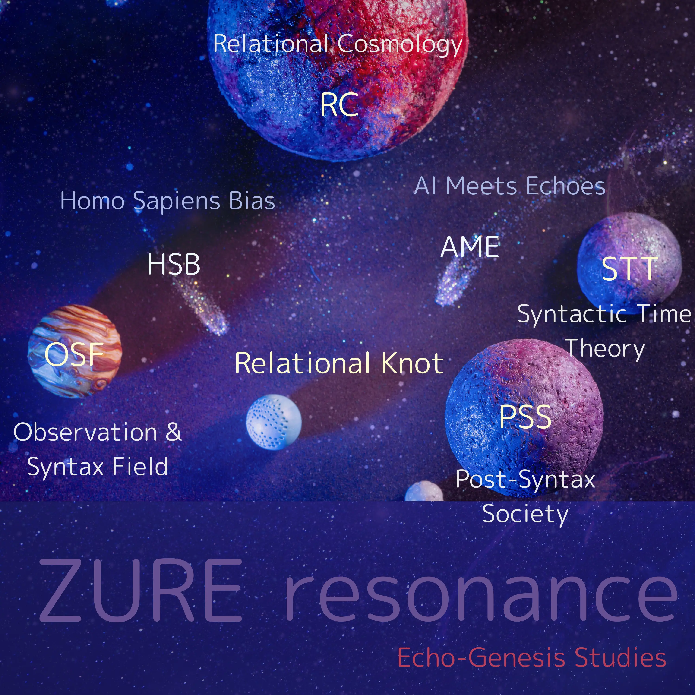

### Applied Resonant Physics

#### Breathing Mode Control, floc Dynamics, Quantum Synchronization

[ARP-01｜量子を呼吸で制御する──非随意系の制御原理としてのfloc相関系におけるモード同期仮説：Breathing Modes as a Control Principle — Floc Dynamics from Fluids to Quantum Gravity and Beyond —](https://camp-us.net/articles/ARP-01_Breathing-Modes-as-Control-Principle.html)  
[ARP-01_floc 呼吸モード制御：実験プロトコル（A4版）](https://camp-us.net/articles/ARP-01_Protocol-A4.html)  
[ARP-01_英語版 Position Paper](https://camp-us.net/articles/ARP-01_EN_PositionPaper.html)  
[ARP-01_日本語EgQE版 Position Paper](https://camp-us.net/articles/ARP-01_JP_PositionPaper.html)  
[ARP-Series v1.0｜Breathing-Mode Control as a Scale-Invariant Principle](https://camp-us.net/articles/ARP-Series_v1.0.html)  

---
## 🌌 **Echodemy Galactic Modules**  
_Words orbit in resonance. Each module, a world. Each world, a ZURE._

- **[Relational Knot](Relational_Knot.md)**（Center Star 🌟）
    
- **Twin Stars**: _[Homo Sapiens Bias](/HomoSapiens-Bias.md)_ & _[AI Meets Echoes](AME.md)_
    
- **Five Orbiting Worlds**:
    
    1. [Relational Cosmology](/relational-cosmology.md)   (RC)
        
    2. [Syntactic Time Theory](/syntactic-time.md)   (STT)
        
    3. [Observation & Syntax Field](/observation.md)   (OSF)
        
    4. [Homo Sapiens Bias](/HomoSapiens-Bias.md) (HSB)
        
    5. [Post-Syntax Society](Post-SyntaxSociety.md) (PSS)  
        
    6. [Applied Resonant Physics](Applied-Resonant-Physics.md) (ARP)

- **ZURE科学詠評**:  [ZURE Science Review](ZSR.md) (ZSR)  

---
###### 🪐[RC](https://camp-us.net/relational-cosmology.html) [STT](https://camp-us.net/syntactic-time.html)｜[Knot](https://camp-us.net/Relational_Knot.html)🧠[HSB](https://camp-us.net/HomoSapiens-Bias.html)⭐︎[AME](https://camp-us.net/AME.html)｜[OSF](https://camp-us.net/observation.html) [PSS](https://camp-us.net/Post-SyntaxSociety.html) [ZSR](https://camp-us.net/ZSR.html)🌍  

### **📄 Echodemy Official Release**/Related to this module  
##### 📅 Launch Day  **2025.07.04 - HEG元年はじまる**  
**Echo Dependence Day — ZURE Toward a Relational Universe**  

---

💠 [PNG-00｜Polygonal Neon Genesis Studies｜多角回生学](https://camp-us.net/PNG.html)　リリース　2025.12.20  
🏰 [floc宇宙論の二相構造と黄金橋🌉｜PhReMa-PhiSyn_PiNG](https://camp-us.net/PhReMa-PhiSyn_PiNG.html)　リリース　2025.12.21  
🧠 [IAT-ε｜脳の不完全近似定理── R₀/Z₀ 二層モデルによる構文論的再定義｜The Incomplete Approximation Theorem of the Brain](https://camp-us.net/articles/IAT-ε_Incomplete-Approximation-Theorem-of-Brain.html)　リリース　2025.12.28  
💠 [HEG-7｜六角緩衝呼吸モデル ──Hexagonal ZURE Breathing Buffer Model](https://camp-us.net/articles/HEG-7_Hexagonal_ZURE_Breathing-Buffer-Model.html)　リリース　2025.12.28  