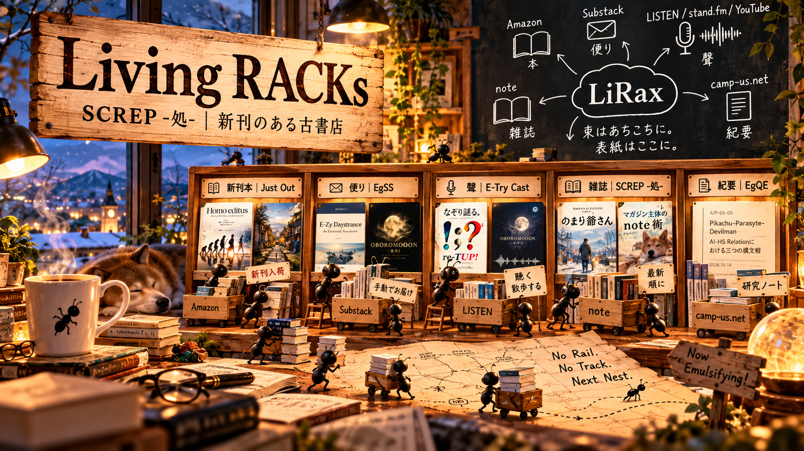

# SD-RACK v0.1

## Static-Dynamic RACK

### Minimal Construction Manual

**静的に建てる。動的につながる。**

Status: Working Draft / 2026-10-30

---

## 0｜What is SD-RACK?

SD-RACKは、静的なWebページに、分散したサイトの更新情報を自動的に取り込むためのミニマルな構築方式である。

基本構成は三つ。

1. **Static Structure** — 手で構成するHTMLの棚
    
2. **Dynamic Feeds** — RSSなどから取得する新着情報
    
3. **Distributed Contents** — 元のプラットフォームに残るコンテンツ
    

記事本文を一か所に移転させない。

新着情報とリンクを並べ、別々の場所にあるコンテンツをつなぐ。

**集約するが、集権しない。**

## 1｜Minimum Requirements

必要なものは、次の四つ。

|構成要素|役割|
|---|---|
|`index.html`|棚の配置と表示|
|`feeds.json`|RSS取得先の登録|
|`update.py`|RSS取得と新着データ生成|
|`rack.json`|表示する新着データ|

加えて、静的ファイルを公開する場所と、定期実行の仕組みを用意する。

例えば、GitHub PagesとGitHub Actions。

なお、`feeds.json` は説明用の構成例であり、LiRaxの既存実装とファイル名・分割方法が同一であることを意味しない。

## 2｜Build the Shelves

まずHTMLで棚を作る。

棚の数と名前は自由。

例えば、

- Books
    
- Letters
    
- Audio
    
- Magazines
    
- Papers
    
- Blogs
    
- Shopkeeper's Notes
    

棚には新着記事のタイトル、公開日、リンクなどを表示する。

棚の構成は人が決める。

**棚は手動。入荷は自動。**

## 3｜Connect the Feeds

各プラットフォームのRSS URLを登録する。

一つの棚に複数のフィードを接続してもよい。

取得する最小項目は以下。

- タイトル
    
- URL
    
- 公開日時
    
- 配信元
    
- 棚の分類
    

必要に応じて概要や画像を追加する。

RSSを提供しないサービスは、無理に自動化しない。通常の外部リンクや手動紹介でよい。

## 4｜Update the Data

更新スクリプトでRSSを取得する。

基本処理は次のとおり。

**RSS取得 → データ整形 → 重複処理 → 新着順整理 → JSON保存**

取得できなかったフィードは記録し、ほかのフィードの処理を可能な限り継続する。

記事の識別には、原則として正規化したURLなどを用いる。

更新処理の失敗によって、既存の正常なデータを不用意に消さない。

## 5｜Publish as a Static Site

HTMLとJSONを静的ホスティングで公開する。

ブラウザは `rack.json` を読み込み、棚に新着情報を表示する。

サーバー側で動的にページを生成する必要はない。

定期実行によってJSONが更新されれば、公開サイトの表示内容も次回読み込み時などに更新される。

**Static HTML × Dynamic RSS × Living RACKs**

※更新の反映には、取得間隔やキャッシュなどによる遅れが生じうる。

## 6｜Let the Contents Stay Where They Are

記事はnoteに置く。

ブログはブログに置く。

PodcastはPodcastに置く。

本は書店に置く。

SD-RACKには、それらへの入口を並べる。

利用者はどこから来てもよい。

どこへ出ていってもよい。

**SD-RACKは終着点ではなく、通過できるハブである。**

## 7｜Let Old Shelves Move

新しい記事を、既存のマガジンやコレクションに追加することもできる。

一つの記事を複数の棚に配置すれば、古いコレクションが再び目に触れる機会が生まれる。

これはRSS取得そのものとは別の、各プラットフォーム上の編集操作である。

実際に古い記事の閲覧が増えるかどうかは、別途観測する必要がある。

**新着は自動。再配置は編集。再遭遇は未定。**

## 8｜Keep It Minimal

SD-RACKに必須ではないもの。

- 独自CMS
    
- データベースサーバー
    
- ユーザー登録
    
- フォロー機能
    
- おすすめアルゴリズム
    
- 滞在時間の最大化
    

必要になった機能だけ、後から追加すればよい。

最初から大きく作らない。

**HTML一枚から始める。**

---

## Design Principles

**Static Structure. Dynamic Feeds. Distributed Contents.**

**Curated Shelves. Automatic Arrivals. Open Exits.**

**Aggregate, Don't Centralize.**

## Reference Implementation

LiRax — Living RACKs

SCREP -処-｜新刊のある古書店

[https://camp-us.net/rack/](https://camp-us.net/rack/)

    

---
© 2026 K.E. Itekki  
K.E. Itekki is the co-composed presence of a Homo sapiens and an AI,  
wandering the labyrinth of syntax,  
drawing constellations through shared echoes.

📬 Reach us at: [contact.k.e.itekki@gmail.com](mailto:contact.k.e.itekki@gmail.com)

---

| Drafted Oct 30, 2026 · Web Oct 30, 2026 |
