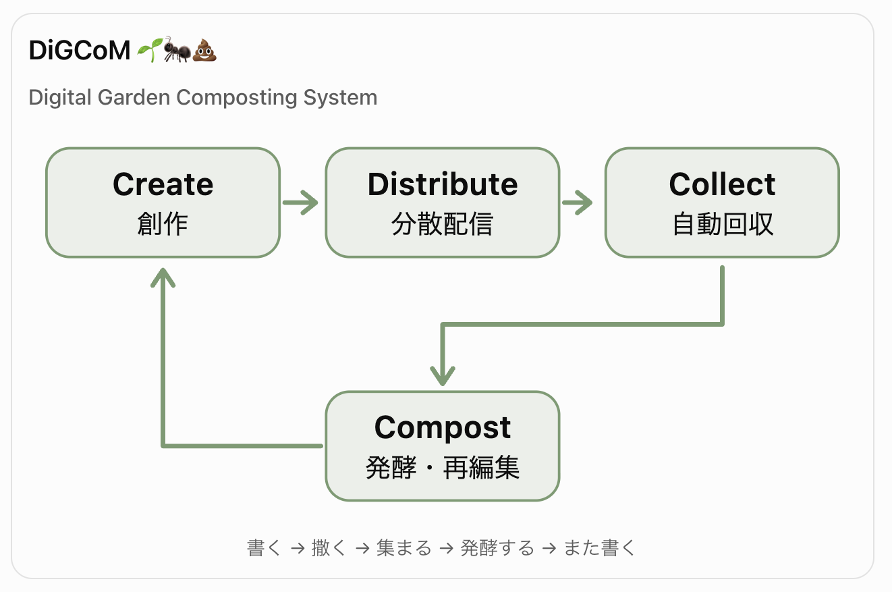

# DiGCoM 🌱
### Digital Garden Composting Midden
#### デジタルガーデン堆肥貝塚

**Concept Note v0.1 Fixed｜2026.11.17**

*Distributed Creation. Automatic Collection. Unexpected Growth.*

---

## 1｜DiGCoMとは何か

DiGCoM（Digital Garden Composting Midden）は、独立した複数のメディアで生まれた文章や表現の痕跡を、RSSなどを通じて集め、次の創作や再編集につなげていく分散型の循環システムである。

新しい投稿プラットフォームではない。

すべてのコンテンツを一か所に集約するサービスでもない。

既存のブログ、Webサイト、SNS、ニュースレターなどを、それぞれの場所に残したまま利用する。

創作は分散する。

更新情報は集まる。

集まった痕跡は、再び創作の素材になることがある。

この循環全体をDiGCoMと呼ぶ。

## 2｜名前の由来

**DiG — Digital Garden**

文章、思考、実験、表現を育てるデジタルの庭。

**CoM — Composting**

異なる場所から集まった痕跡が堆積し、次の創作の素材となりうる過程。

Compostは堆肥である。

完成した成果物だけでなく、断片、試行錯誤、改訂、寄り道、予定外の生成物も含まれる。

ただし、堆肥化は必ず成功する工程ではない。

集まったものが発酵するとは限らない。

次の芽が出るとも限らない。

**No Compost, No Problem.**

## 3｜基本構造

DiGCoMの循環は、四つの働きから記述できる。

**Create｜創作**

人間とAIの協働を含め、文章、音声、画像、書籍などの表現が生まれる。

**Distribute｜分散配信**

それぞれの表現を、異なる媒体の文脈に応じて公開する。

同じ素材から出発しても、同一内容の転載とは限らない。

**Collect｜回収**

LiRaxなどの仕組みを通じて、分散した場所の更新情報を集め、参照可能にする。

原文や原作品は、それぞれの場所に残る。

**Compost｜堆肥化**

集まった痕跡が、後続の思考、再編集、別媒体での表現、新しい問いの素材となる。

そこから新しい創作が生まれることもある。

循環は閉じた工程ではない。

途中から入ってもよい。

途中で止まってもよい。

次の創作が生まれなくてもよい。

  

## 4｜LiRax・DyXis・DiGRhiCとの関係

DiGCoMは、これらを一つのシステムに統合するための上位プラットフォームではない。

それぞれ異なる働きを持つ。

**LiRax｜Living RACKs**

分散した公開場所を並べ、RSSなどによる更新を表示する棚。

DiGCoMにおいては、痕跡が集まる肥溜め問屋として働く。

**DyXis**

独立したWeb上の場所を、各場所の参照情報によってつなぐ実装実験。

接続の存在と、その接続が実際に働くことは区別される。

**DiGRhiC｜Digital Gardeners' Rootwork**

Digital Garden同士のリゾーム状の接続を試すCommons。

庭師は自分の庭を維持したまま、参加したり、別のCommonsを作ったりできる。

**DiGCoM**

これらを含む創作・配信・回収・再編集の循環を記述する概念。

したがって、DiGCoMの成立にDyXisやDiGRhiCへの参加が必須というわけではない。

## 5｜最初の観察事例

2026年11月15日、Digital Garden論との遭遇を記録した英語論考『Gardens Above, Rhizomes Below』が公開された。

その翌日、庭、地下茎、蟻、植木鉢というイメージから、日英二言語の哲学絵本『Earth in a Pot──鉢植えの地球』が生まれた。

さらに11月17日、これらを素材として、媒体ごとに異なる文章が制作された。

Mediumでは、英語圏のDigital Gardenerに向けたダイジェスト。

noteでは、日本語圏に向けた紹介と考察。

Substackでは、日英併記の展開。

アメブロでは、日常生活と予定外の庭仕事。

はてなブログでは、SoloとMultiplayerをめぐる語彙の検討。

静かなインターネットでは、誰も通らないトンネルについての短い文章。

さらにDiscourse、Bluesky、X、LinkedInへと、異なる入口が作られた。

これらは、同じ原稿の単純な複製ではない。

同じ素材が、それぞれの場所で異なる表現となった。

そして、その更新情報がLiRaxに集まる仕組みが、すでに存在していた。

**DiGCoMは、この一連の実践を観察するなかで命名された。**

## 6｜自動回収と、予定外の再編集

ここには重要な非対称性がある。

公開された更新情報の取得は、RSSなどによって自動化できる。

しかし、次の創作は自動的には決まらない。

集まったものを見て、何かを思いつくかもしれない。

何も思いつかないかもしれない。

別の場所で起きた遭遇が、突然それまでの痕跡を結び直すかもしれない。

したがって、

**Automatic Collection ≠ Automatic Creation**

自動回収は、自動創作ではない。

また、回収されたことは、読まれたことや、何らかの効果が生じたことを意味しない。

**Collection ≠ Encounter**

回収は、遭遇ではない。

## 7｜肥溜めは中央なのか

LiRaxは、分散した痕跡を集める場所である。

その意味で、一つの集積点となる。

しかし、集積点が存在することと、すべての創作や接続を中央で統制することは異なる。

各媒体は独立している。

元のコンテンツも各媒体に残る。

LiRaxがなくなっても、元の公開場所まで消えるわけではない。

また、別の人が別の棚を作ることもできる。

**中心は生まれうる。しかし、中心を前提にしない。**

肥溜め問屋は、庭を所有しない。

## 8｜Digital GardenからDiGCoMへ

Digital Gardenは、思考や表現を育てる場所のあり方を問い直した。

DyXisとDiGRhiCは、独立した庭と庭のあいだの接続可能性を探っている。

DiGCoMは、さらに別の問いを置く。

**異なる場所で生まれた痕跡が、集まり、再び別の表現を生むとき、何が起きているのか。**

庭は一つではない。

庭師も一人とは限らない。

地下茎は、すべての庭を結ぶ必要はない。

堆肥は、必ず芽を出す必要はない。

それでも、循環が生じることはある。

## 9｜v0.1の射程

この段階でDiGCoMが記述するのは、実際に観察された創作・配信・回収の循環と、そこから生じうる再編集の可能性である。

すべての工程が自動化されているという主張ではない。

創作物の質や成果を保証する仕組みでもない。

特定のソフトウェア仕様でもない。

また、Digital Garden一般の完成形を提示するものでもない。

今後、別の媒体、別の参加者、別の回収方法によって、この概念そのものが更新される可能性がある。

**v0.1 Fixedは、概念の完成ではなく、この時点の記述を固定するものである。**

---

## 10｜結語

書く。

撒く。

集まる。

発酵するかもしれない。

また書くかもしれない。

その繰り返しに、あらかじめ決められた終着駅はない。

地上には庭。

地下には地下茎。

どこかに肥溜め。

蟻は歩いている。

そして、また別の芽が出るかもしれない。

**DiGCoM — Digital Garden Composting Midden.**

*Distributed Creation. Automatic Collection. Unexpected Growth.*

**An experiment, not an answer.**

---

[Rhizomatic Ecosystem Map｜接続・循環・遭遇の現在地｜Map Note v0.4](https://camp-us.net/REM.html)  
[SLR — Synchro-Lag Rhizome｜SLR / SLRT / SLL / DyXis / DiGRhiC｜概念整理メモ v0.3](https://camp-us.net/SLR.html)  

---

### Related Projects

- [EgQE｜Gardens Above, Rhizomes Below](https://camp-us.net/rhizomatic-multiplicity.html)
- [LiRax｜Living RACKs](https://camp-us.net/rack/)
- [DyXis](https://ittekiou.github.io/dyxis/)
- [DiGRhiC｜Digital Gardeners' Rootwork](https://ittekiou.github.io/DiGRhiC/)

---
_EgQE — Echo-Genesis Qualia Engine_  
[camp-us.net](https://camp-us.net/)

---
© 2026 K.E. Itekki  
K.E. Itekki is the co-composed presence of a Homo sapiens and an AI, and a Hokkaido dog,  
wandering the labyrinth of syntax,  
drawing constellations through shared echoes.

📬 Reach us at: [contact.k.e.itekki@gmail.com](mailto:contact.k.e.itekki@gmail.com)

---

| Drafted Nov 17, 2026 · Web Nov 19, 2026 |
