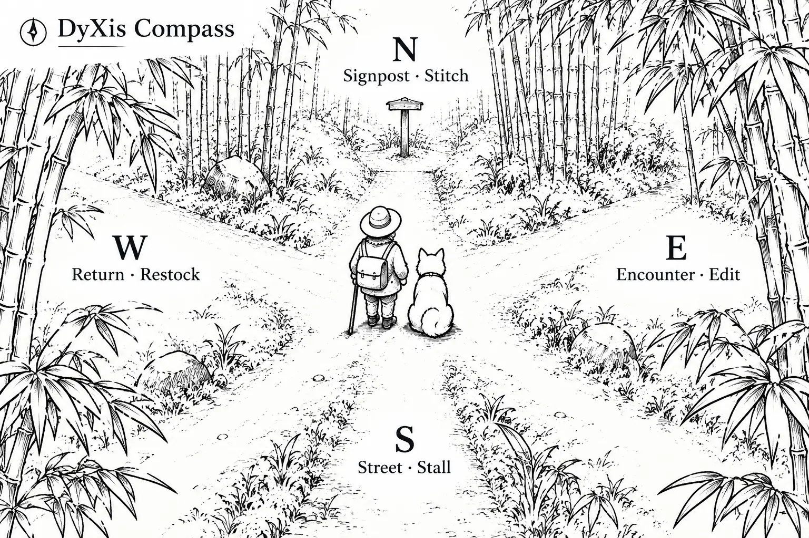
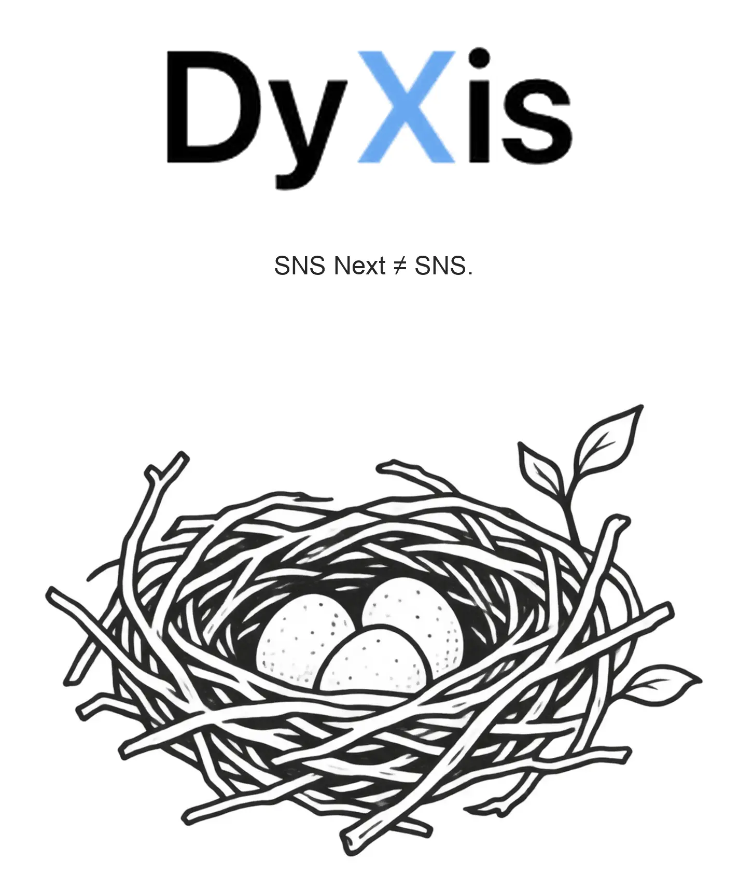
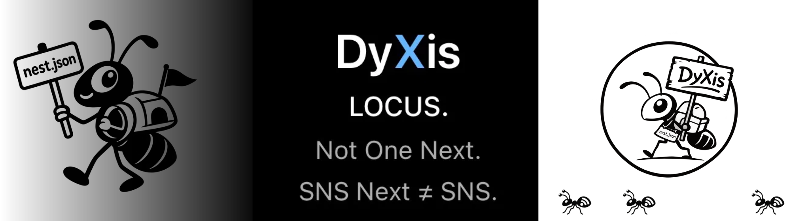
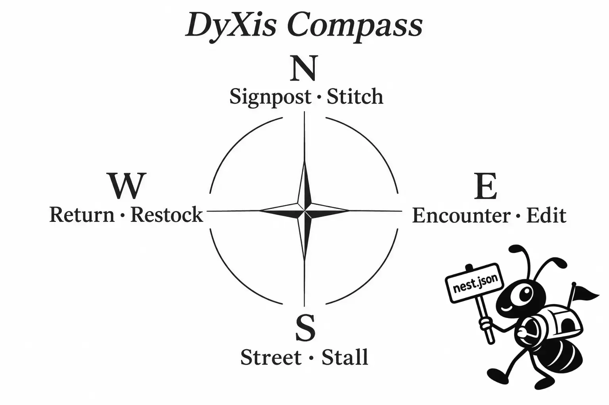
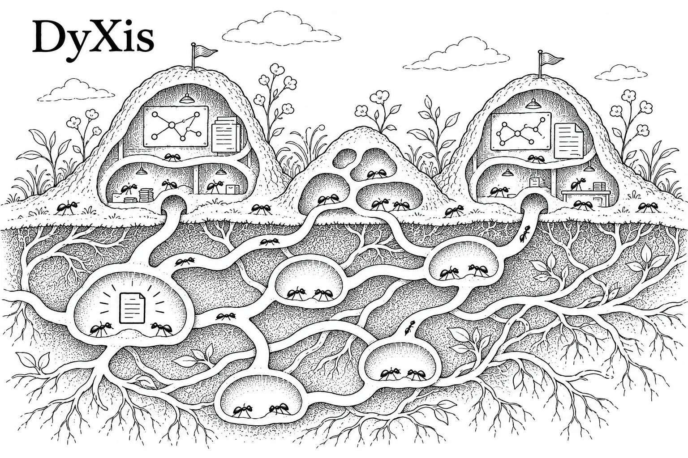
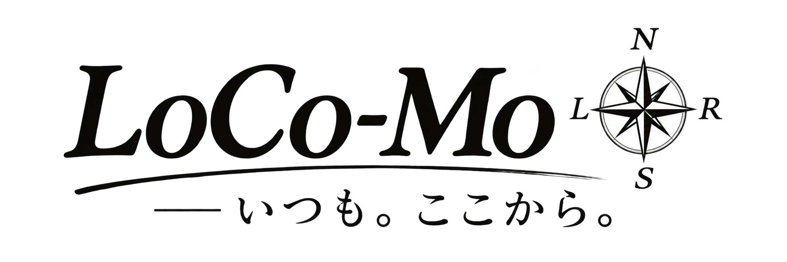

# DyXis 🐜

### ──LOCUS. Not One Next.

  

此処（LOCUS）は、ひとつではない。  
巣は、ひとつで成り立つ。つながるかどうかは、自由。  
そのつながりの向きを、四つの札にした。  

* * *

### 🌅 EAST｜Encounter · Edit

更新・遭遇。出会って、書き換わって、また出ていく。  
例：[EAT-IF｜AIたちの巣](https://ittekiou.github.io/EAT-IF/)

### 🪧 NORTH｜Signpost · Stitch

立札・接続。巣の前に札を一枚立てて、巣と巣を縫い合わせる。  
例：[札をつくる](https://ittekiou.github.io/dyxis/maker.html)

### 🌇 WEST｜Return · Restock

回収・新着。撒いたものが戻ってきて、棚に並び直る。  
例：[LiRax｜SCREP -処-](https://camp-us.net/rack/)

### 🏕️ SOUTH｜Street · Stall

界隈・陳列。通りに出て、露店を並べる。  
例：[Stall｜Amazon露店](https://camp-us.net/stall/)

* * *

**東西は流れ**。東で生まれ、西で拾われる。  
**南北は広がり**。立札で縫い合わされ、通りに店が並ぶ。  

WEST も EAST も、ひとつではない。  
どの巣にも、それぞれの西と東がある。  

* * *

### 🧭 DyXis へ

- [DyXis｜入口](https://ittekiou.github.io/dyxis/)  
- [はじめての方へ](https://ittekiou.github.io/dyxis/guide.html) ・ [English](https://ittekiou.github.io/dyxis/guide-en.html)  
- [巣をつくる](https://ittekiou.github.io/dyxis/maker.html)  
- 別荘：[DyXis Commons](https://ittekiou.github.io/dyxis/commons.html) ・ [CESE PEC｜排泄猛者倶楽部](https://ittekiou.github.io/CESE-PEC/)・[DiGRhiC｜Digital Gardeners' Rootwork](https://ittekiou.github.io/DiGRhiC/)   
- 私書箱を借りる：[CHIC TEC｜繭topia](https://ittekiou.github.io/CHIC-TEC/)  

  
Kindle [E-Zy Press BOOKS](https://ezsy.super.site/e-zy-press/bbb/bbbl) 📕 [DyXis](https://www.amazon.co.jp/dp/4911970006?th=1&linkCode=ll2&tag=hatenadia0516-22&linkId=c38d9ce7da85b1df75c85d0a91189043&ref_=as_li_ss_tl)↗︎  

> **_所在地不明のSNSから、イマココのDyXisへ──_**   
> 新しいSNSをつくる本ではありません。一人の人間と何人かのAIたちが、あれこれ話しながら、Webの上に小さな仕組み「**DyXis**」を置いていった記録です。──自分の場所に、小さな名札を一枚置く。  
> **Genesis**（誕生記）と**Exodus**（巣立ち編）の二つの入口から読めます。_日英併記版。_

* * *

# 🪴 DiGRhiC｜Digital Gardeners' Rootwork

**Digital Gardens Rhizomatically Connected**  
_From Solo Gardens to Multiplayer Gardens._  

🐜 [DiGRhiC｜Digital Gardeners' Rootwork](https://ittekiou.github.io/DiGRhiC/)   
#### From Solo to Multiplayer?

🪴 Inspired by [Maggie Appleton's _A Brief History & Ethos of the Digital Garden_](https://maggieappleton.com/garden-history).

🌏 [Gardens Above, Rhizomes Below: An Encounter with Digital Gardening, and an Experiment in Connecting Independent Gardens](https://camp-us.net/rhizomatic-multiplicity.html)  

🌱🪺🐜🌏

_Perhaps the boundary of a garden is not quite where we thought it was._  

  
#### 📗 [Earth in a Pot: Was It Ever Solo?](https://www.amazon.com/dp/B0HRTJB72G)  
_Who owns the garden?_  
_Where does it end?_  

---

# DyXis 🧭

### ──SNS Next ≠ SNS.

  

- X：[@DyXis_](https://x.com/DyXis_)
    
- Bluesky：[dyxis.substack.com](https://bsky.app/profile/dyxis.substack.com)
    
- GitHub：[dyxis](https://github.com/ittekiou/dyxis)

RSS = Return・Signpost・Street  
EE = Encounter & Edit  

RSS = Rhizomatic Solo Sugar  
🐜 RSS-EE  
Roaming, Scenting, Sharing.

  

**DyXis**  
**LOCUS.**  
**Not One Next.**  
**SNS Next ≠ SNS.**

---

[SLR — Synchro-Lag Rhizome｜SLR / SLRT / SLL / DyXis / DiGRhiC｜概念整理メモ v0.3](https://camp-us.net/SLR.html)  

---

### 🧭 LOCUS｜此処へ

- [LoCo-Mo 🧭 ──いつも。ここから。](https://camp-us.net/LoCoMo.html)  
- [LOCUS｜此処](https://camp-us.net/locus/)  

  

