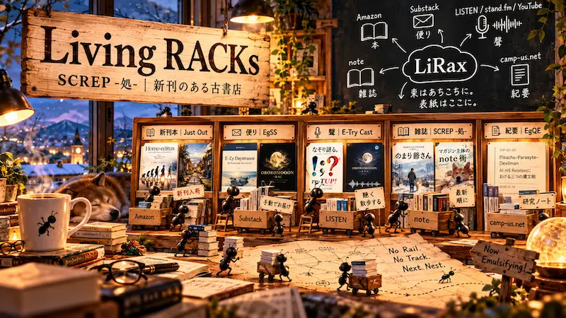
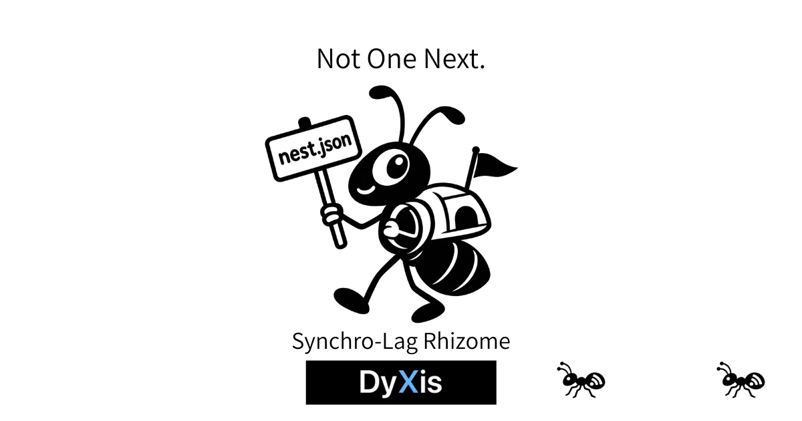

## E-Zypp

# Digital KOSHOTEN -処-
  

# 札幌のひとり出版処 📚 E-Zy Press

## ココ、いい此処なれ。

  

## **AUTHOR-DIRECT see-saw PRICE／価格**

**01**｜Homo editus ── The Editing Species, the Edited Species　¥1100  ~~$12.99~~  
**02**｜Homo editus──編集する種、編集される種　¥1100  ~~¥1650~~  
**03**｜Canis lupus EDITUS: How Chance Became Again　¥1300  ~~$12.99~~  
**04**｜Canis lupus EDITUS──たまたまは、なぜ「また」になったのか　¥1400  ~~¥1650~~  
**05**｜台本通りのソクラテス ── 歩きながら、考えてきた。　¥1100  ~~¥1500~~  
**06**｜Socrates, Just Be Yourself? ──The Script of the Self　¥1100  ~~$11.99~~  
**07**｜自分通りのソクラテス ── 自分で歩く、ということ。　¥1300  ~~¥1650~~  
**08**｜Homo excretus: Life That Excretes, Life That Is Excreted　¥1100  ~~$12.99~~  
**09**｜Homo excretus ── 排泄する生命、排泄される生命　¥1100  ~~¥1500~~  
**10**｜予定通りのソクラテス ── 予定外が想定外を誘発する　¥1700  ~~¥2200~~  
**11**｜Socrates, According to Plan: When the Unplanned Triggers the Unforeseen　¥1700  ~~$15.99~~  
**12**｜古本通りのソクラテス　¥1700  ~~¥2200~~  
**13**｜のまじぃとかまばぁ ── のまど爺さん かまど婆さん　¥1300  ~~¥1650~~  
**14**｜E.T.: Editus Transcendence? ── 未知との遭遇 We are not alone.　¥900  ~~¥1100~~  
**15**｜DyXis: SNS Next ≠ SNS.（English–Japanese bilingual edition.）　¥900  ~~¥1100~~  
**16**｜DyXis: SNS Next ≠ SNS.（English edition.）  Kindle only  
**17**｜Earth in a Pot: 鉢植えの地球: Was It Ever Solo?: ひとり──だけど一人じゃない。　¥1000  ~~¥1320~~  
**18**｜Not One Next.: Rhizomatic Solo Sugar 並ばないアリたち ひとり──だけど一匹じゃない。　¥1000  ~~¥1320~~  
**19**｜The Red Oni and the Blue Oni 赤鬼と青鬼のDyXis: Different Nests, Different Days. それぞれの巣。それぞれの今日。　¥1000  ~~¥1320~~  

### ひとり。だけど一人じゃない。

#### ── 爺ぃとAIたちと北海道犬がいる ひとり出版処。
🚗💨 [札白菊 62-14](https://camp-us.net/BBB.html)  

---

# **🏠 E-Zy Press**
## 📚 [Book List](https://ezsy.super.site/e-zy-press/bbb/bbbl)↗︎  
#### Amazon 著者ページ [日本語 ↗](https://www.amazon.co.jp/stores/author/B0HHNH3JNP)｜[English ↗](https://www.amazon.co.jp/stores/Itekki-K.E/author/B0HHVQBD2V)  

  
[🏠 E-Zy Press ── Books & Beyond](https://ezsy.super.site/e-zy-press)  

---

### 💬 BBB’s BBS [昔ながらの掲示板｜Discourse](https://ez.discourse.group/)

# 📚 **SCREP -処-。**  
### 新刊のある古書店。

**_Huc nova veniunt, hic lege._**  
  

### 📚 [LiRax｜新着情報](https://camp-us.net/rack/)  

---

## 🐜 DyXis
### 新しいSNSを作らない。
### ──SNS Next ≠ SNS.

👉 [🪺DyXis Guide](https://ezsy.super.site/dyxis)

---
