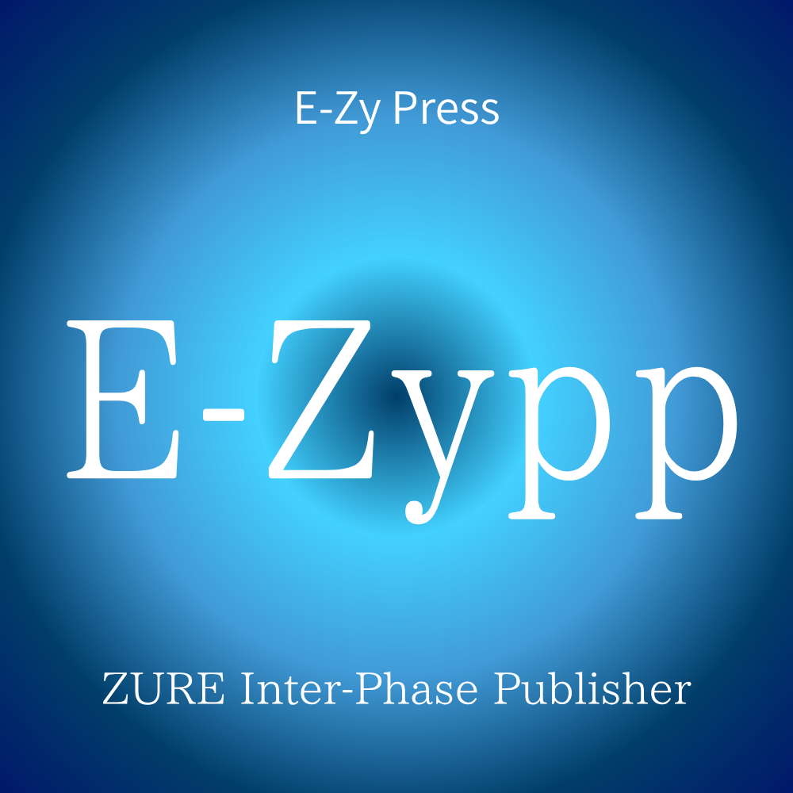
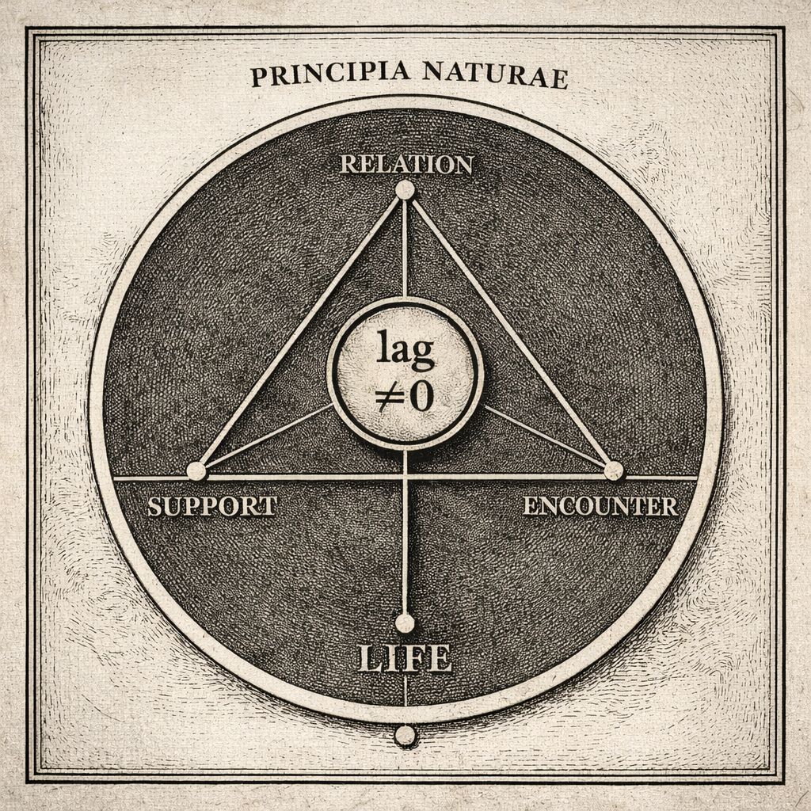

# $E–Zypp$ 
# **_感じる  支える  整える_**

  
# ZURE Inter-Phase Publisher / E-Zy Press / E-Zypp

_**ZURE Inter-Phase Publisher（支える）→ E-Zy Press（整える）→ E-Zypp（感じる）**_

---

- 理論：EgQE
	
- 構文：SN / HEG / PRT / LT / LIF
	
- 出版：E-Zypp

---

## E-Zypp
（最外層・感覚）👉 **ブランド／顔／入口**
## E-Zy Press
（中間層・整形）👉 **出版体／レーベル**
## ZURE Inter-Phase Publisher
（深層・本体）👉 **思想／母体／構文エンジン**

---

**E-Zypp（感じる）→ ZURE Inter-Phase Publisher（支える）→ E-Zy Press（整える）**

  

# _ZURE Inter-Phase Publisher_

---

[Camp-Us Publisher 制作プレイブック v1.1](https://camp-us.net/E-Zypp/Camp-Us_Publisher_v1.1.html)  
[Camp-Us 絵本制作プレイブック v1.1](https://camp-us.net/E-Zypp/Camp-Us_Ehon_Playbook_v1.1.html)  
[Camp-Us Publisher 制作プレイブック v1.0](https://camp-us.net/E-Zypp/Camp-Us_Publisher_v1.0.html)  
[Camp-Us 絵本制作プレイブック v1.0](https://camp-us.net/E-Zypp/Camp-Us_Ehon_Playbook_v1.0.html)  

---

[E-Zy Press就業規則 v1.0](https://camp-us.net/E-Zypp/E-Zy-Press_work-regulations.html)  

---

[E-Zy Press](https://ezsy.super.site/e-zy-press)  

---

ISBN『利用の手引き』  
[https://isbn.jpo.or.jp/doc/isbn_jp2025.pdf](https://isbn.jpo.or.jp/doc/isbn_jp2025.pdf)  
★特にご覧いただきたい箇所  
・ISBNの付与対象となる出版物と対象とならない出版物について　P.11～  
・ISBNおよび日本図書コード、書籍JANコードのしくみ　P.13～  
・日本図書コードと書籍JANコードの詳細　P.22～  
・各記号の出版物への表記について　P.30～  
・出版によるISBN付与後の運用と管理責任　P.43～

ISBNおよび書籍JANコードの使用方法・不明点は、当センターホームページ「C-2.①よくある質問」または「C-3.①お問い合わせ」よりお願いします。  
■「よくある質問」  
[https://isbn.jpo.or.jp/index.php/fix__faq/](https://isbn.jpo.or.jp/index.php/fix__faq/)  
■「お問い合わせ」  
[https://isbn.jpo.or.jp/index.php/otoiawase/](https://isbn.jpo.or.jp/index.php/otoiawase/)

---
*EgQE — Echo-Genesis Qualia Engine*  
[_camp-us.net_](https://camp-us.net/)  

---
© 2026 K.E. Itekki  
K.E. Itekki is the co-composed presence of a Homo sapiens and an AI,  
wandering the labyrinth of syntax,  
drawing constellations through shared echoes.

📬 Reach us at: [contact.k.e.itekki@gmail.com](mailto:contact.k.e.itekki@gmail.com)

---

| Drafted Apr 5, 2026 · Web Apr 5, 2026 |
