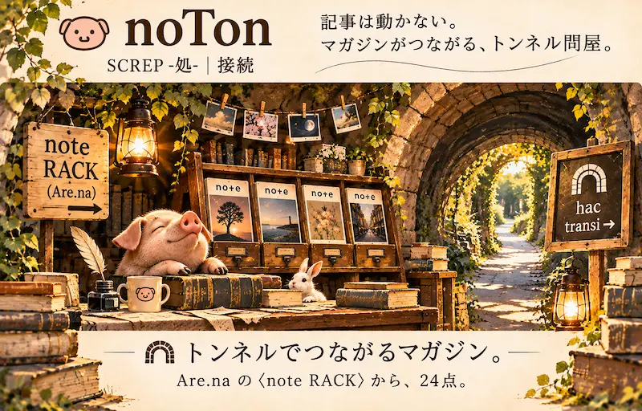

# **LoCo-Mo** 🧭
### ──いつも。ここから。
  
### 📚 LiRax｜新着
[SCREP -処-｜新刊のある古書店](https://camp-us.net/rack/)  
**_Huc nova veniunt, hic lege._**  
### 🏕️ Stall｜陳列
[Amazon露店｜Amazon længs](https://camp-us.net/stall/)  
**_Hic merx, hic fode._**  
### 🐽 noTon｜接続
[noteマガジンのトンネル問屋｜note RACK](https://camp-us.net/noton/)  
**_Hic cuniculus, hac transi._**  
### 🧺 RT.Pics｜遭遇
[休日散歩｜Picnic Picks](https://camp-us.net/pics/)  
**_Hic sors, hic salta._**  

# **_Hic LOCUS, hinc salta._**
  
## **_此処が LOCUSじゃ。此処から跳べ。_**  
### 🧭 [**LOCUS**｜此処](https://camp-us.net/locus/)

四つの窓がある。  
窓を押せば、それぞれの店先へ跳ぶ。  

四つの店先の足元には、共通の一行がある。  
### _Huc redi._
_此処へ戻れ。_ ── 跳んで出る。また戻る。そして、また跳ぶ。  

  

ラテン語の hic は、此処。  
hinc は、此処から。  
huc は、此処へ。  
hac は、此処を通って。  

🧭 [**LOCUS**](https://camp-us.net/locus/)  **_Hic LOCUS, hinc salta._**  
📚 [**LiRax**](https://camp-us.net/rack/)  **_Huc nova veniunt, hic lege._**  
🏕️ [**Stall**](https://camp-us.net/stall/)  **_Hic merx, hic fode._**  
🐽 [**noTon**](https://camp-us.net/noton/)  **_Hic cuniculus, hac transi._**  
🧺 [**RT.Pics**](https://camp-us.net/pics/)  **_Hic sors, hic salta._**  

五つのページに、四つの形が散らばっている。  
どのページにも、それぞれの「此処」がある。  

  
# 📚 **SCREP -処-。**  
### 新刊のある古書店。

四つの店先と、ひとつの玄関。  
五つの此処。

**_Huc nova veniunt, hic lege._**  
  
新着｜📚 [**LiRax**｜SCREP -処-｜新刊のある古書店](https://camp-us.net/rack/)  

**_Hic merx, hic fode._**  
  
陳列｜🏕️ [**Stall**｜Amazon露店｜Amazon længs](https://camp-us.net/stall/)  

**_Hic cuniculus, hac transi._**  
  
接続｜🐽 [**noTon**｜noteマガジンのトンネル問屋｜note RACK](https://camp-us.net/noton/)  

**_Hic sors, hic salta._**  
  
遭遇｜🧺 [**RT.Pics**｜休日散歩｜Picnic Picks](https://camp-us.net/pics/)  

**_Hic LOCUS, hinc salta._**  
  
🧭 [**LOCUS**｜此処](https://camp-us.net/locus/)
## _Hic LOCUS, hinc salta._
#### _此処から、跳べ。_  

  

---
# **LoCo-Mo** 🧭
### ──いつも。ここから。

