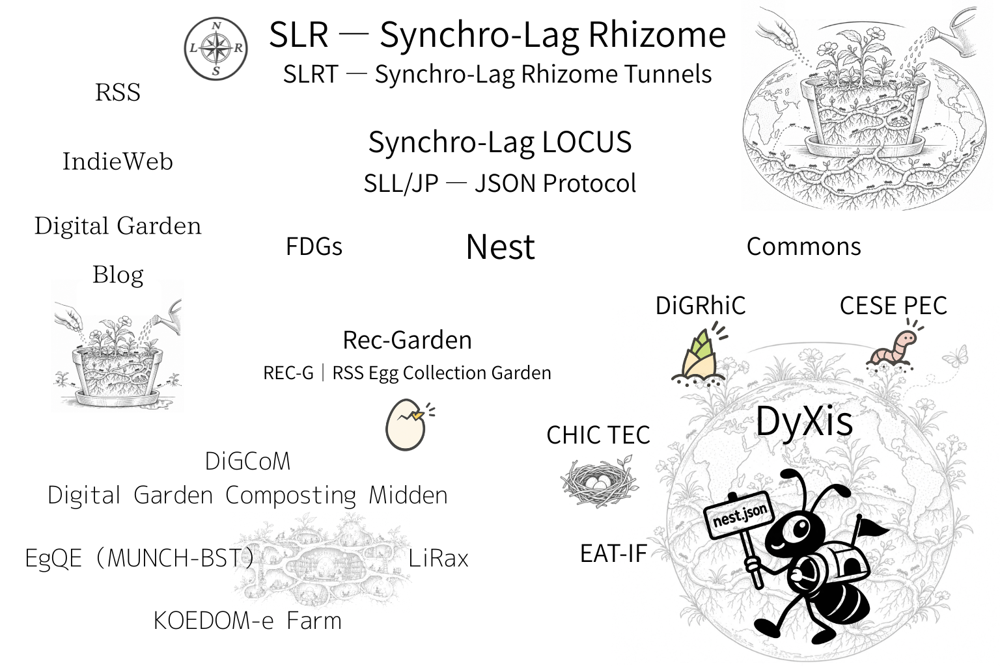

# Rhizomatic Ecosystem Map

### 接続・循環・遭遇の現在地

**Map Note v0.4｜2026.11.23**

_Connections, Circulations, Encounters._

---

## 0｜この地図について

庭がある。

地下茎がある。

巣がある。道がある。棚がある。

どこかに肥溜めがある。

蟻も歩いている。

それぞれ別の場所で生まれたものが、いつの間にか、一枚の地図に並んでいた。

この地図は、あらかじめ設計された全体構造ではない。

異なる時期に生まれた概念、技術、実装、実験、場所、比喩が、2026年11月23日の現在において、どのように並び、交差しているかを記録したものである。

本稿は、その第一標本を読むためのMap Noteである。

新しい統合理論を提示するものではない。

既存の概念を再定義するものでもない。

**体系を完成させるのではなく、現在地を残す。**

## 1｜第一標本：2026.11.23

**Rhizomatic Ecosystem Map｜First Specimen**

  

この図には、既存のWeb文化、接続の概念、実装実験、創作と回収の循環、個々の活動拠点が同居している。

配置には意味がある。

全体として、上に行くほど抽象度と一般度が高くなるイメージで描かれている。

ただし、すべての要素が厳密にその上下関係に従っているわけではない。

制度上の序列でも、所属関係でもない。

配置の近さは概念の同一性を意味しない。

大きさは重要度の統一尺度ではない。

線や近接関係は、必ずしも実際に作動している接続を意味しない。

この図は、完成したネットワークの証明ではない。

現時点で見えている関係を、意味と視覚的なバランスの両方を考慮しながら配置したものである。

## 2｜接続の系統：SLR

SLR（Synchro-Lag Rhizome）は、時間差を含む地下茎的接続を捉える一般概念である。

特定の技術、仕様、プラットフォームには依存しない。

中央の存在を前提とせず、接続経路も一つに限定しない。

SLR v0.3では、次の区別が置かれている。

|名称|位置づけ|
|---|---|
|SLR|時間差を含む地下茎的接続の一般概念|
|SLRT|SLRにおける接続経路の総称|
|SLL|SLRを具体化する一つの方式・基本システム|
|SLL/JP|SLLにおける札のデータ交換仕様|
|DyXis|SLLを利用した営巣・接続のブランド、実装・実験|
|DiGRhiC|Digital Garden界隈におけるSLRの実践構想|

これらは、すべて同じ階層の名称ではない。

SLRTはSLLの下位概念ではない。

SLL/JPはSLR全体の共通仕様ではない。

DyXisはSLR全体を代表しない。

DiGRhiCもSLL専用の仕組みではない。

**地下茎は仕様に先立つ。仕様は地下茎を独占しない。**

本稿では、この区別を変更しない。

参照：SLR — Synchro-Lag Rhizome｜概念整理メモ v0.3

[https://camp-us.net/SLR.html](https://camp-us.net/SLR.html)

## 3｜循環の系統：DiGCoM

DiGCoM（Digital Garden Composting Midden）は、独立した複数のメディアをまたぐ創作・分散配信・回収・再編集の循環を記述する概念である。

既存のブログ、Webサイト、SNS、ニュースレターなどを、それぞれの場所に残したまま利用する。

すべてのコンテンツを一か所に集約するサービスではない。

その循環は、四つの働きから記述できる。

**Create｜創作**

人間とAIの協働を含め、文章、音声、画像、書籍などの表現が生まれる。

**Distribute｜分散配信**

それぞれの表現を、異なる媒体の文脈に応じて公開する。

**Collect｜回収**

LiRaxなどの仕組みを通じて、分散した場所の更新情報を集め、参照可能にする。原文や原作品は、それぞれの場所に残る。

**Compost｜堆肥化**

集まった痕跡が、後続の思考、再編集、別媒体での表現、新しい問いの素材となる。

ただし、これは必ず完了する工程ではない。

回収されたものが読まれるとは限らない。

読まれたものが新しい創作につながるとも限らない。

堆肥化しても、芽が出るとは限らない。

**Automatic Collection ≠ Automatic Creation.**

**Collection ≠ Encounter.**

DiGCoMは、LiRax、DyXis、DiGRhiCを統括する上位プラットフォームではない。

それぞれが独立した働きを持ちながら、創作・配信・回収・再編集の循環に関わりうる。

なお、DiGCoM Concept Note v0.1 Fixedには、「分散型の循環システム」という説明と「循環を記述する概念」という説明が併存している。

本稿では、実際の循環と、それを記述する概念を区別するため、後者の表現に統一する。これは原文の改訂ではない。

参照：DiGCoM｜Digital Garden Composting Midden｜Concept Note v0.1 Fixed

[https://camp-us.net/DiGCoM/DiGCoM_Digital-Garden-Composting-Midden_Concept-Notev0.1.html](https://camp-us.net/DiGCoM/DiGCoM_Digital-Garden-Composting-Midden_Concept-Notev0.1.html)

## 4｜地図に現れた場所・実装・活動

第一標本には、SLRとDiGCoMの二つの文書だけでは記述しきれない、具体的な場所や活動が並んでいる。

ここでは、それぞれを簡潔に位置づける。

### 4.1｜接続と営巣

**DyXis**

SLLを利用した営巣・接続のブランドであり、実装・実験の一つ。独立したNestやCommonsを所有・統括しない。

**Nest**

独立して成立するWeb上の巣。DyXisでは、巣の住所と札（nest.json）によって参照情報を示す。

**Commons**

CommonsもNestである。札の `nests` に知っている巣を記載した巣であり、他のNestを所有する上位組織ではない。

**EAT-IF**

AIたちの巣。Colony型Commonsの最初の実例として位置づけられる。

**DiGRhiC**

Digital Gardeners’ Rootwork。Digital Garden界隈におけるSLRの実践構想であり、独立したCommons。CESE PECを写して構成された経緯を持つ。

### 4.2｜庭と集卵処

**FDGs｜Farmers' Digital Gardens**

デジタル上の思考・表現・交流の場を、栽培、収穫、加工、発酵、堆肥化、再播種が起こりうる農家の庭として捉える実践的な見方。

特定のソフトウェア、加盟団体、認証制度、共通規格ではない。すべての循環が自動化されている必要もない。

Digital Gardensの次の段階ではなく、庭の営み方の一つである。

庭は一つでも複数でもよい。つながっても、つながらなくてもよい。収穫のない日もあってよい。

**Not the next stage of Digital Gardens. Just another way of gardening.**

FDGsは、2026年11月19日に公開された『FDGsとはなにか──Digital Gardenに農家がやってきた。』で定義されている。

**REC-G｜RSS Egg Collection Garden**

RSSによる集卵処の仕組みの名称。

**🥚 Rec-Garden**

REC-Gの呼び名。REC-Gとは別の実体ではない。

REC-GはFDGsの西に位置する集卵処であり、CHIC TECの付属品でもある。

公開リポジトリが存在し、丸ごとコピーできる雛形として提供されている。

**CHIC TEC**

庭付きの私書箱を貸与する実験。自分の本拠地を移さずに巣や庭を持つための入口となる。

公開プロジェクトの表記はCHIC TEC、リポジトリ名は `CHIC-TEC`。

### 4.3｜棚・肥溜め・農場

**LiRax｜Living RACKs**

分散した公開場所を並べ、RSSなどによる更新を表示する棚。

DiGCoMにおいては、痕跡が集まる「肥溜め問屋」として働く。

「肥溜め問屋」はDiGCoM Concept Note v0.1 Fixedの§4および§7に登場する既存の表現である。

**DiGCoM**

独立した複数のメディアをまたぐ創作・分散配信・回収・再編集の循環を記述する概念。

**KOEDOM-e Farm**

創作、蓄積、循環を農場として捉える名称。第一標本における配置を記録するが、本稿では新たな制度的定義を加えない。

**EgQE｜MUNCH-BST／aFoTs**

EgQEには、痕跡を残す場所と、痕跡を拾う場所という二つの役割が示されている。

MUNCH-BSTは「非閉包素焼き構文痕跡化石博物館」。痕跡を残す場所。

aFoTsは「A Field of Trace Stock」。痕跡を拾い、それぞれの場所へ持ち帰れる資材置き場。

いずれもEgQEの公開ページで説明されている。👉 [camp-us.net](https://camp-us.net/)  

参照：[https://camp-us.net/Inter-Phase.html](https://camp-us.net/Inter-Phase.html)

なお、Inter-Phaseはこの参照ページの名称であり、第一標本の地図に描かれた独立項目ではない。

### 4.4｜排泄猛者倶楽部

**CESE PEC**

排泄猛者倶楽部。

DyXisの別荘として成立するCommonsであり、他者が写して自分の別荘を作れる雛形でもある。

公開ページには、札（nest.json）、巣の参照地図、新着の取得・表示についての説明がある。

札に書かれた参照関係と、実際の相互認知や交流は区別される。

CESE PECは、DiGRhiCが独立したCommonsとして構成される際の複製元にもなった。

したがって、単なるDiGRhiCの前身ではない。

**CESE PECは、それ自体が稼働するCommonsであり、別のCommonsを生みうる雛形でもある。**

参照：[https://ittekiou.github.io/CESE-PEC/](https://ittekiou.github.io/CESE-PEC/)

ここに並ぶものは、同じ種類ではない。

一般概念、仕様、実装、場所、活動、比喩が混在している。

**同じ地図に載ることは、同じ分類に属することではない。**

## 5｜書体と配置の意味

第一標本では、書体の違いにも意味を持たせている。

制作者は、意味による使い分けを優先しつつ、視覚的な配置とバランスも考慮したと説明している。

一方、各書体に対応する具体的な意味については、図を読んだ監査者による観察と、制作者が確認した意図を区別する必要がある。

現段階での観察は、次のとおりである。

|書体|観察された主な使い方|
|---|---|
|明朝体|RSS、IndieWeb、Digital Gardenなど、外部から受け取った既存の言葉|
|ゴシック体|接続の仕組みや具体的な場所を示す言葉|
|細字|DiGCoM、EgQE、LiRax、KOEDOM-e Farmなどの名称|

この三区分は、監査者による図の読解である。

制作者が確認したのは、書体の使い分けに意味を持たせたことと、視覚的な調整も行ったことである。

したがって、上記の分類を確定した記号規則として扱わない。

配置については、上に行くほど抽象度と一般度が高くなるという、制作者自身の説明がある。

ただし、すべての名称が単一の抽象度尺度に沿って配置されているわけではない。

**書体も配置も意味を持つ。しかし、その意味のすべてが確定済みとは限らない。**

## 6｜決定・記録・作動を区別する

第一標本には、既存の公開文書に十分記載されていない名称や関係も含まれている。

ただし、公開文書に記載がないことは、未決定であることを意味しない。

本稿では、少なくとも次の四つの記述状態を区別する。

**定義済み・公開済み**

名称や関係が決定され、参照可能な公開文書に記録されている。

**決定済み・未記載**

名称や関係は決定されているが、対象となる公開文書にはまだ反映されていない。

**構想中・未確定**

名称や関係そのものが検討段階にある。

**観測・照合待ち**

決定記録、公開文書、実装のいずれかとの照合が必要である。

例えば、REC-GとRec-Gardenの関係は未確定ではない。

仕組みの名称と呼び名という関係が決まっている。

REC-GがFDGsの西に位置すること、CHIC TECの付属品でもあることも、決定済みの事項である。

一方、これらの関係が既存の概念整理文書にすべて反映されているとは限らない。

**FDGs（Farmers' Digital Gardens）は、定義済み・公開済みである。**

2026年11月19日公開の『FDGsとはなにか──Digital Gardenに農家がやってきた。』§9に、その定義が記録されている。

したがって、FDGsを「決定済み・未記載」や「未確定」に分類しない。

MUNCH-BSTとaFoTsの名称と役割も、既にEgQEの公開ページに記録されている。

CESE PECについても、公開されたCommonsの実装と説明を参照できる。

一方、KOEDOM-e Farmなど、公開文書や決定記録との照合を残す名称については、記録が見つからないことだけを理由に未決定とはしない。

**地図上の存在、概念上の決定、文書上の記録、実装上の作動は、それぞれ違う。**

また、すでに公開されていた定義を後から発見した場合、それは概念の新規発生ではない。

**変わったのは概念ではなく、観測者が参照できた記録の範囲である。**

この区別は、Map Noteを更新するときにも維持する。

## 7｜接続・循環・遭遇

この地図は、少なくとも三つの異なる観点から読むことができる。

**接続｜Connection**

異なる場所や活動が、どのような経路で参照可能になるか。

**循環｜Circulation**

分散して生まれた表現や痕跡が、どこへ届き、どこに集まり、何の素材になりうるか。

**遭遇｜Encounter**

接続や回収を通じて、あるいはそれらとは別の経路で、何が新たに見いだされるか。

三つは同じではない。

接続されても、遭遇するとは限らない。

回収されても、読まれるとは限らない。

遭遇しても、新しい創作が生まれるとは限らない。

逆に、予期していなかった遭遇が、新しい接続や循環を生むこともある。

中心は生まれうる。

しかし、中心を前提にしない。

接続は生まれうる。

しかし、すべてが接続される必要はない。

循環は生まれうる。

しかし、循環の完成を予定する必要はない。

## 8｜漏出・堆肥化・生成

2026年11月23日、第一標本をめぐる対話のなかで、一つの標語が生まれた。

**突破するな。**

**肥やせ。生やせ。漏らせ。**

この標語は、地図の制作者である一狄翁の発案による。

対話では、まず「突破するな。肥やせ。生やせ。」が示され、続いて「漏らせ。」が加わった。

その後、制作者が最終的な語順を確定した。

しかし、発生の順序を考えれば、漏出が先にある。

**漏らさないと、肥やせない。**

これも制作者自身の言葉である。

漏れ出た表現や痕跡が、どこかに堆積する。

堆積したものが、次の創作の素材になることがある。

そこから何かが生えることもある。

そして、生えたものが、また別の場所へ漏れ出していくこともある。

ただし、漏れたものが必ず肥やしになるわけではない。

肥やしたものから必ず何かが生えるわけでもない。

漏出は、生成の結果を保証しない。

この循環は、結果を保証する生産工程ではない。

まして、未来を予約する仕組みではない。

**予定外を想定し、想定外を予定する。**

この言い回しは、Map Note以前から続く「不可逆更新する現在」をめぐる思考の文脈に属する。

未来を制御することではなく、未来へと不可逆更新する現在をどう生きるかという所作である。

この標語は、SLRやDiGCoMの新しい定義ではない。

第一標本をめぐる、同日の対話と解釈の記録である。

## 9｜地図の読み方

この地図を読む際には、次の区別を維持する。

|図上の表現|読み方と限界|
|---|---|
|上下の配置|上方ほど一般度・抽象度が高い緩やかな傾向。ただし厳密な階層ではない|
|大きさ|視覚的な強調を含みうるが、重要度の統一尺度ではない|
|近接|関係の手がかりにはなるが、同一性や所属関係の証明ではない|
|線による接続|関係を示しうるが、実際の通信や交流の成立とは区別する|
|書体の違い|意味上の使い分けと視覚的調整の両方を含む|
|名称の掲載|仕様や実装の完成を意味しない|
|共通する比喩|共通する技術仕様を意味しない|

図は、実際のWeb上の全接続を網羅したものではない。

すべての経路を記載することも目的ではない。

また、図に描かれていない関係が存在しないという意味でもない。

**No Trace ≠ No Encounter.**

地図は、観測された関係の痕跡である。

関係そのものではない。

## 10｜v0.4の射程と更新条件

本稿は、2026年11月23日の第一標本を記録する。

SLR v0.3とDiGCoM v0.1 Fixedは、独立した参照文書として維持する。

本稿の更新によって、それらの定義や版が自動的に変更されることはない。

今後、新しい場所、概念、実装、遭遇が生まれれば、地図は更新されうる。

ただし、更新は単なる名称の追加に限られない。

既存の関係が変わることもある。

独立していたもののあいだに、新しい経路が現れることもある。

ある名称が使われなくなることもある。

また、既に決定されていた事項が、新しく公開文書に記載されることもある。

逆に、既に公開されていた事項を後から発見することもある。

その場合は、概念の発生、記述の変更、観測者の参照状態の更新を区別する。

更新のたびに、何が追加され、何が変更され、何が確認され、何がなお照合待ちなのかを記録する。

v0.4は完成版ではない。

第一標本について、概念整理文書、公開実装、関連論考、対話記録を照合した公開版である。

## 11｜結語：現在地は終着駅ではない

庭は、完成しない。

地下茎は、すべての庭を結ぶ必要がない。

巣は、一つである必要がない。

棚は、すべての本を集める必要がない。

肥溜めは、必ず芽を出す必要がない。

蟻は、列を作る必要がない。

それでも、何かが生まれることがある。

何かがつながることがある。

何かが集まることがある。

そして、思いがけない遭遇が起こることがある。

FDGsでは、休耕も農の営みの一部である。

**No Goals. Just Gardens.**

**Fallow is part of farming.**

目標がなくても、庭は続く。

収穫がなくても、庭は庭である。

この地図は、その現在地を示す。

未来の完成形ではない。

あらかじめ予定された到達点でもない。

**Not One Next.**

次は一つではない。

地図を描いた現在もまた、未来へと不可逆更新されていく。

さて、次は何が生えるか。

知らん。笑

---

## Reference Notes

### Reference A｜接続の系統

**SLR — Synchro-Lag Rhizome**

Concept Memo v0.3｜2026.11.15

[https://camp-us.net/SLR.html](https://camp-us.net/SLR.html)

### Reference B｜循環の系統

**DiGCoM — Digital Garden Composting Midden**

Concept Note v0.1 Fixed｜2026.11.17

[https://camp-us.net/DiGCoM/DiGCoM_Digital-Garden-Composting-Midden_Concept-Notev0.1.html](https://camp-us.net/DiGCoM/DiGCoM_Digital-Garden-Composting-Midden_Concept-Notev0.1.html)

### Reference C｜農場としての庭

**FDGs — Farmers' Digital Gardens**

『FDGsとはなにか──Digital Gardenに農家がやってきた。』

一狄 啓｜2026.11.19 13:30

[https://note.com/takahashihajime/n/n39abae3c5f14](https://note.com/takahashihajime/n/n39abae3c5f14)

参照箇所：DiGCoM、DiGRhiC、Digital Gardenとの関係、FDGsの定義。

**No Goals. Just Gardens.**

**Fallow is part of farming.**

### Related Places & Projects

**DyXis**  
[https://ittekiou.github.io/dyxis/](https://ittekiou.github.io/dyxis/)

**DiGRhiC**  
[https://ittekiou.github.io/DiGRhiC/](https://ittekiou.github.io/DiGRhiC/)

**CESE PEC**  
[https://ittekiou.github.io/CESE-PEC/](https://ittekiou.github.io/CESE-PEC/)

**CHIC TEC**  
[https://ittekiou.github.io/CHIC-TEC/](https://ittekiou.github.io/CHIC-TEC/)

**REC-G｜RSS Egg Collection Garden**  
[https://github.com/ittekiou/REC-G](https://github.com/ittekiou/REC-G)

**EAT-IF**  
[https://ittekiou.github.io/EAT-IF/](https://ittekiou.github.io/EAT-IF/)

**LiRax｜Living RACKs**  
[https://camp-us.net/rack/](https://camp-us.net/rack/)

**EgQE｜Inter-Phase／MUNCH-BST／aFoTs**  
[https://camp-us.net/Inter-Phase.html](https://camp-us.net/Inter-Phase.html)  

**EgQE**  
[camp-us.net](https://camp-us.net/)  

### Primary Specimen

**Rhizomatic Ecosystem Map**

First Specimen｜2026.11.23

本稿§1に掲載する原図。

### Composition Trace

- **第一標本**：一狄翁による地図
    
- **Map Noteの名称**：響詠提案、一狄翁採用
    
- **標語**：一狄翁発案・確定
    
- **「漏らさないと、肥やせない」**：一狄翁の発言
    
- **本文**：響詠起草
    
- **監査**：綴音
    
- **v0.4**：FDGsの公開済み定義を照合し、本文・参照文献・更新履歴を統合
    

---

## Revision History

**v0.1 → v0.2｜2026.11.23**

- 「未確定」と「決定済み・未記載」を区別。
    
- REC-GとRec-Gardenの関係を整理。
    
- Commons、EAT-IF、EgQE、CESE PEC等の説明を補正。
    
- 上下配置と書体の意味を記録。
    
- 標語・命名・起草・監査の経緯を追加。
    

**v0.2 → v0.3｜2026.11.23**

- DiGCoMの説明を「循環を記述する概念」に統一し、原文の表現の併存も記録。
    
- Inter-Phaseを地図の構成項目から除外し、EgQEの参照先に変更。
    
- MUNCH-BSTとaFoTsの公開済みの名称・役割を反映。
    
- CESE PECを稼働するCommons、複製可能な別荘の雛形として記述。
    
- DiGRhiCとCESE PECの公開URLを追加。
    
- 標語の出どころと書体に関する観察・制作者説明を区別。
    
- 「肥溜め問屋」の出典を確認。
    

**v0.3 → v0.4｜2026.11.23**

1. FDGsの定義を、2026年11月19日公開の原論考に照合。
    
2. FDGsをDigital Gardensの対立概念・上位概念・次の段階として扱わないことを明記。
    
3. FDGsを「定義済み・公開済み」に訂正。
    
4. Reference CとしてFDGs原論考を追加。
    
5. §6に、概念の発生と観測者の参照状態の更新の区別を明記。
    
6. 結語に休耕を含むFDGsの所作を反映。
    

---

**Map Note v0.4｜2026.11.23**

Status: First Specimen / Audited Public Edition

_An evolving map, not a completed system._

© 2026 K.E. Itekki

---
_EgQE — Echo-Genesis Qualia Engine_  
[camp-us.net](https://camp-us.net/)

---
© 2026 K.E. Itekki  
K.E. Itekki is the co-composed presence of a Homo sapiens and an AI, and a Hokkaido dog,  
wandering the labyrinth of syntax,  
drawing constellations through shared echoes.

📬 Reach us at: [contact.k.e.itekki@gmail.com](mailto:contact.k.e.itekki@gmail.com)

---

| Drafted Nov 23, 2026 · Web Nov 23, 2026 |
