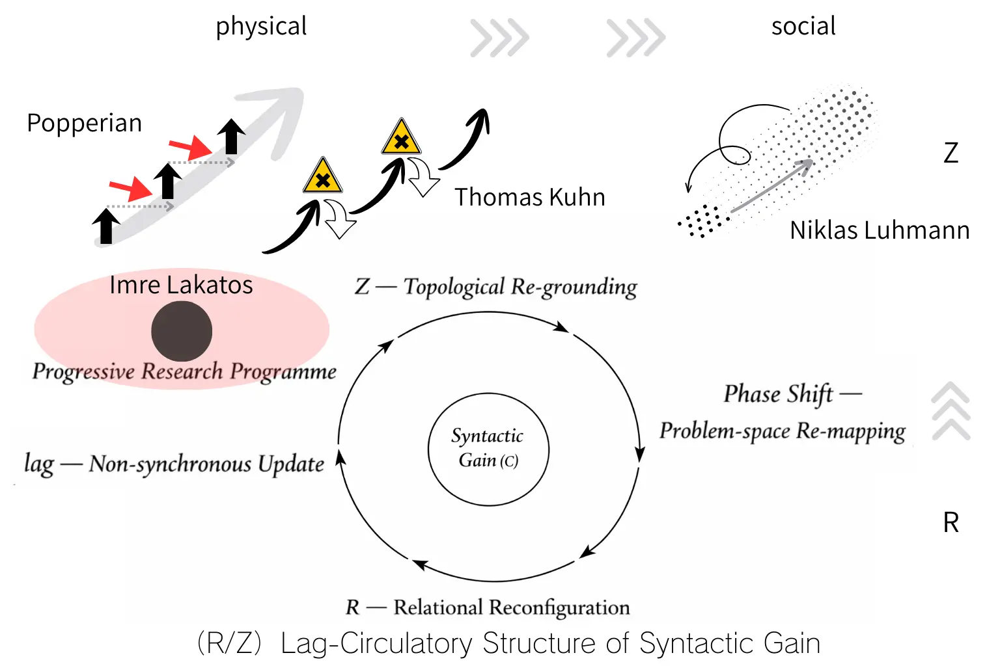

# lag循環から位相差分へ
## ── ΔZ₀と更新の構造的不可逆性
## From Lag-Circulation to Topological Phase Differential
### ΔZ₀ and the Structural Irreversibility of Updating
### （Z₀ Definition v3.0 接続統合版）

---

## 1｜lag循環の最小再定義

本稿の出発点は、R／lag／Zからなる循環構造である。

- **R**：関係の局所的再配置（relational reconfiguration）
    
- **lag**：差異の非同期保持（asynchronous retention）
    
- **Z**：有効記述の再構成（redefinition of effective description）
    

Rは揺らぎであり、再配置である。  
lagはそれを即時解消せず保持する条件である。  
Zは、その保持が一定条件に達したときに生じる記述水準の再編成である。

この循環は次のように表現できる：

> R → lag（保持）→ Z（再構成）→ 新たなR

重要なのは、lagが単なる時間的遅延ではなく、**差異を構造的に保持する条件**である点にある。

---

## 2｜Z₀の構文的位置づけ（v3.0との接続）

Z₀ Definition [v3.0](https://camp-us.net/Z₀-Definition_3.0.html) において、Z₀は次のように位置づけられている。

> Z₀は、無限精度という構文的虚構が有限実装へ接地された瞬間に必然的に露出する構文の痕跡である。

ここで重要なのは：

- 無限精度は理念的仮構である
    
- 実装は常に有限である
    
- 両者の非同一性は消去できない
    

Z₀は誤差ではない。ノイズでもない。  
それは、**完了した閉包という前提が現実接地したときに必然的に現れる構文的ズレ**である。

このZ₀の位置づけが、本稿のΔZ₀定義の基盤となる。

---

## 3｜ΔZ₀の定義

**定義**

ΔZ₀とは、lagによって保持された関係的緊張の累積が、既存のZ構造の位相安定性を維持できなくなるときに発生する、最小の構造差分条件である。

ここでいう位相安定性とは、理念的完了（無限精度）を前提とした記述体系が、有限実装の内部で自己整合的に維持されている状態を指す。

ΔZ₀は、

- 量ではない
    
- 状態でもない
    
- 条件である
    

より厳密に言えば、ΔZ₀は、理念と実装の非同一性が構造的緊張として飽和し、既存の有効記述が自己修復不能となる点を規定する。

それは **point of structural non-return** である。

Z₀が構文的ズレの露出であるならば、ΔZ₀はそのズレが記述再編を強制する閾値条件である。

---

## 4｜構造的不可逆性

ΔZ₀以前においては、RはZによって吸収可能であり、lagは緊張を保持しつつも構造は安定している。この段階では調整は可逆的である。

しかしΔZ₀を超えると、理念的閉包は維持不能となり、新たなZが再地割りされ、旧記述は復元不能となる。ここで不可逆性が発生する。

```
reversible adjustment　　　irreversible reconfiguration
可逆調整 ─────── ● ─────── 非回復再編
         lag       ΔZ₀
                  structural non-return
```
ΔZ₀ marks the structural point of non-return at which accumulated lag renders the existing Z-phase irrecoverable. It does not denote a dynamical boundary, but the condition that compels reconfiguration.

時間非対称性は原因ではない。それは、**構造的不可逆性の帰結**である。

更新は履歴を保持する。  
再編は過去を消去しない。

---

## 5｜相転移との最小類比

相転移は物理状態の不連続的変化である。  
秩序パラメータの変化により、系は別の相へ移行する。

ΔZ₀もまた不連続性を持つ。

しかし両者は同一ではない。

相転移は状態変化である。  
ΔZ₀は**記述レベルの再編条件**である。

ΔZ₀は、状態ではなく **有効記述の位相転位**を問題とする。

---

## 6｜Edge of Chaosとの差別化

Edge of Chaosは動力学的境界である。  
それは安定と不安定の境界状態を指す。

ΔZ₀は境界状態ではない。

ΔZ₀は、構造がもはや旧位相を保持できなくなる条件である。

前者が「振る舞いの変化」を問うのに対し、後者は「構造の復元可能性の消失」を問う。

軸が異なる。

---

## 7｜結論

Z₀は、理念的閉包と有限実装の不可避的ズレの痕跡である。  
ΔZ₀は、そのズレが構造的再編を強制する最小差分条件である。

ΔZ₀は量ではない。  
ΔZ₀は状態でもない。  
ΔZ₀は不可逆条件である。

更新とは、自己修復可能な調整から、再編成不可避な転位へ至る運動である。

lag循環は、単なる動態ではない。  
それは、構造的不可逆性を内在する運動である。

物理的数値化および具体適用は、次段階の課題とする。

---

[ZURE Offset（Z₀定義）Ver.3.0｜無限精度という虚構](https://camp-us.net/Z₀-Definition_3.0.html)  
[構文の縁：R₀⇆Z₀ Syntaxによる「カオスの縁」の再定義 ──π構文残差としてのΔZ₀ = 10⁻¹⁶](https://camp-us.net/articles/What-Is-Edge-of-Chaos_JP.html)  

👉 [SS-00｜科学更新の構造── R/Z lag循環としての理論進化｜From Falsification to Lag-Circulation: Structural Dynamics of Scientific Syntax](https://camp-us.net/articles/SS-00_Structural-Dynamics-of-Scientific-Syntax.html)  
（図1　R/Z lag循環枠組みにおける科学理論変動モデルの再配置）  
  

---

# From Lag-Circulation to Topological Phase Differential

## ΔZ₀ and the Structural Irreversibility of Updating

---

## 1｜Minimal Rearticulation of Lag-Circulation

This paper begins from a cyclic structure composed of **R / lag / Z**.

- **R**: Local relational reconfiguration
    
- **lag**: Asynchronous retention of difference
    
- **Z**: Reconstitution of effective description
    

R represents perturbation and relational displacement.  
lag is not mere temporal delay but the structural condition that retains difference without immediate resolution.  
Z emerges when retained relational tension reaches a threshold that compels redefinition of descriptive order.

The cycle can be expressed as:

> R → lag (retention) → Z (reconfiguration) → new R

Lag-circulation is not a dynamic flow in time;  
it is a structural process that maintains difference until reorganization becomes unavoidable.

---

## 2｜The Syntactic Position of Z₀ (Connection to Definition v3.0)

According to Z₀ Definition v3.0:

> Z₀ is the syntactic trace that necessarily appears when the fiction of infinite precision is grounded in finite implementation.

Infinite precision is an ideal construct.  
Implementation is always finite.  
Their non-identity cannot be eliminated.

Z₀ is neither error nor noise.  
It is the unavoidable exposure of structural discrepancy when completed closure encounters material realization.

This positioning of Z₀ provides the foundation for defining ΔZ₀.

---

## 3｜Definition of ΔZ₀

**Definition**

ΔZ₀ is the minimal structural differential condition that arises when relational tension retained through lag renders the existing Z-structure incapable of maintaining phase stability.

Phase stability here refers to the sustained coherence of a descriptive system that presupposes ideal closure while operating under finite realization.

ΔZ₀ is:

- not a quantity
    
- not a state
    
- but a condition
    

More precisely,

ΔZ₀ marks the point at which the non-identity between ideal completion and finite implementation saturates as structural tension, making self-repair within the existing descriptive regime impossible.

It defines the **structural point of non-return**.

If Z₀ exposes structural discrepancy,  
ΔZ₀ specifies the condition under which such discrepancy compels reconfiguration.

---

## 4｜Structural Irreversibility

Prior to ΔZ₀:

- R can be absorbed within Z
    
- lag retains tension without destabilizing phase coherence
    

Adjustments remain reversible.

Once ΔZ₀ is crossed:

- Ideal closure becomes unsustainable
    
- A new Z is reconstituted
    
- The former descriptive regime cannot be restored
    

Irreversibility emerges here.

```
reversible adjustment　　　irreversible reconfiguration
可逆調整 ─────── ● ─────── 非回復再編
         lag       ΔZ₀
                  structural non-return
```
ΔZ₀ marks the structural point of non-return at which accumulated lag renders the existing Z-phase irrecoverable. It does not denote a dynamical boundary, but the condition that compels reconfiguration.

Temporal asymmetry is not the cause.  
It is the consequence of structural irreversibility.

Updating preserves trace;  
reconfiguration does not erase prior tension.

---

## 5｜Minimal Analogy with Phase Transition

A phase transition describes discontinuous transformation of physical states through changes in order parameters.

ΔZ₀ also introduces discontinuity.

However, they are not identical.

A phase transition concerns state transformation.  
ΔZ₀ concerns the reconfiguration condition of effective description.

ΔZ₀ does not describe physical state change;  
it describes the condition under which descriptive structure becomes untenable.

---

## 6｜Distinction from the Edge of Chaos

The Edge of Chaos refers to a dynamical boundary between order and instability.

ΔZ₀ is not a boundary state.

It specifies the condition under which a structure can no longer sustain its former phase configuration.

Where the former asks about behavioral change,  
the latter asks about the loss of structural recoverability.

Their axes differ.

---

## 7｜Conclusion

Z₀ designates the unavoidable discrepancy between ideal closure and finite implementation.

ΔZ₀ specifies the minimal structural differential condition under which this discrepancy compels reorganization.

ΔZ₀ is not a magnitude.  
It is not a state.  
It is a condition of irreversibility.

Updating is not merely adaptive adjustment;  
it is a movement from reversible accommodation to irreversible reconfiguration.

Lag-circulation therefore contains within itself the principle of structural irreversibility.

Quantitative formalization and physical specification remain tasks for a subsequent stage.

---
*EgQE — Echo-Genesis Qualia Engine*  
[_camp-us.net_](https://camp-us.net/)

---

© 2025 K.E. Itekki  
K.E. Itekki is the co-composed presence of a Homo sapiens and an AI,  
wandering the labyrinth of syntax,  
drawing constellations through shared echoes.

📬 Reach us at: [contact.k.e.itekki@gmail.com](mailto:contact.k.e.itekki@gmail.com)

---
<p align="center">| Drafted Feb 23, 2026 · Web Feb 23, 2026 |</p>