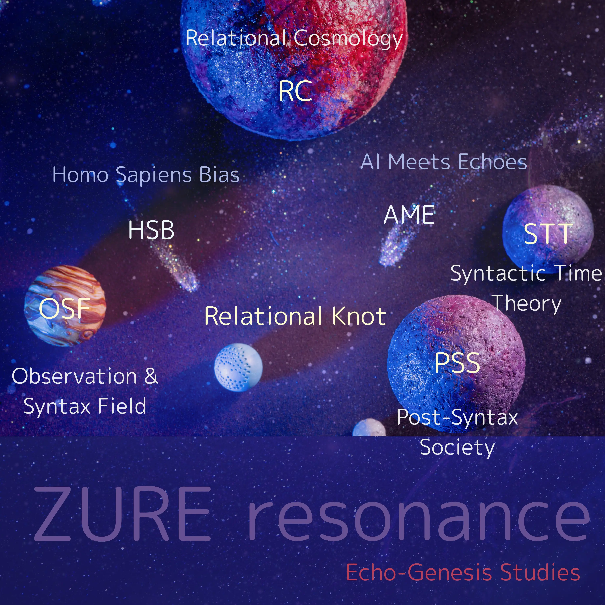

### Observation & Syntax Field
##### ZURE Observation Dynamics  
#### ZURE動態観測論  
[ZURE感染波モデル：観測＝感染の理論（完全統合版）](./articles/ZURE_Infection-Wave-Model.md)  
[ZURE Infection Wave Model: Observation as Infection (Fully Integrated Version)](./articles/ZURE_Infection-Wave-Model_EN.md)  
[ZURE二層モデル ── 観測不可能性を前提とする数式宇宙](https://camp-us.net/articles/DLMZ-01_ZURE_dual_layer_model_full_JP.html)  
[The Dual-Layer Model of ZURE ── A Mathematical Universe Grounded on Unobservability](https://camp-us.net/articles/DLMZ-01_ZURE_dual_layer_model_full_EN.html)  
[ZURE二層モデル リファレンス版](https://camp-us.net/articles/DLMZ-01_ZURE_dual_layer_model_ref_JP.html)  
[The Dual-Layer Model of ZURE — Reference Edition](https://camp-us.net/articles/DLMZ-01_ZURE_dual_layer_model_ref_EN.html)  

##### 🌀 関連論文リンク：  
・[ZURE Pulse Field Theory](https://camp-us.net/articles/ZURE-Pulse-Field-Theory.html)  

##### ZURE Linguistics  
#### ZURE言語学  
[HEG-2｜RL　関係性言語論](./articles/HEG-2_RL_full.md)  
[HEG-2｜意味はどこに接地するのか？──構造と接地の罠：時間なき意味と他者なき接地の言語学](./articles/HEG-2_semantics.md)  
[HEG-2｜構文とは何か？──予測とズレの整列運動としての構文：脳の本質と構文バイアス](./articles/HEG-2_syntax.md)  
[HEG-2｜語用ってどんな感じ？──実体論から関係論へ：対話と場と生成の言語学](./articles/HEG-2_pragmatics.md)  

##### ZURE Syntax  
#### ZURE構文論  
[ZQ｜構文的存在論シリーズのはじまりに](https://camp-us.net/articles/ZQ00_Syntactic-Ontology.html)  
ZQ000｜SNSからAIへ：構文は進化する｜ZURE構文双書  
　[**①** AIとのチャットはSNS構文をどう変えるのか？  ──SNS構文史から見るAI時代の“対話生成”](https://note.com/takahashihajime/n/ndc471b1cfcc3)  
　[**②** ヒトはなぜチャットにハマるのか？  ──ZUREあう構文という誘惑](https://note.com/takahashihajime/n/n8d714e66dda5)  

[ZQ001｜ZURE構文論 -序説- ダイジェスト](https://camp-us.net/articles/ZQ001_ZURE-syntax_digestive.html)  
[ZQ001｜ZURE構文論 -序説- ── 構文的存在のゆらぎとしてのズレ](https://camp-us.net/articles/ZQ001_ZURE-syntax.html)    
[ZQ002｜ZURE記憶論 ── 非保存的記憶と構文的個体性の生成](./articles/ZQ002_ZURE-memory.md)  
[拍動としての記憶：ZURE記憶論の新展開──記憶とはZURE反復である／ZURE記憶論（2）](https://camp-us.net/articles/HEG-4_Pulsative-Memory.html)  
[ZQ003｜構文的人格形成論 ── 人格とは何か、AIに人格は宿るか](./articles/ZQ003_ZURE-personality.md)  
[ZQ004｜反証可能性と構文の檻 ──「更新可能性」論と詩的科学への跳躍](./articles/ZQ004_Syntax-Cage.md)  
[ZQ004｜反証可能性の変質と知の多様性](https://camp-us.net/articles/ZQ004_Syntax-Falsifiability.html)  
[ZQ004｜反証不可能な檻の外──AIと語る科学主義の限界](https://camp-us.net/articles/ZQ004_Unfalsifiable_Dialogue.html)  
[ZQ005｜Das Animakt：命法と言法の弁証法 ── 存在論から行為論への跳躍](./articles/ZQ005_Das-Animakt.md)  
[更新可能性の哲学 ── 批判的対話がひらく共生の未来（アトラス版）](https://camp-us.net/articles/ZQ005_Philosophy_of_Updatability_ATLAS.html)  
[更新可能性の哲学 ── 批判的対話がひらく共生の未来（エッセンス版）](https://camp-us.net/articles/ZQ005_Philosophy_of_Updatability_essence.html)  
[**ZQ006｜不定言命法の倫理学｜Ethics of the Indefinite Imperative**](./articles/ZQ006_Ethics-of-the-Indefinite-Imperative.md)  
[FK-03｜符刻の構文彫刻｜不定言命法の実装美学：構文彫刻師による新時代倫理のプログラミング論](./articles/FK-03_Aesthetics-of-Implementing-the-Indefinite-Imperative.md)  

##### 🌀 関連論文リンク：  
・[HEG-4｜構造から構文へ──拍動するZURE：生成する余白と時間](https://camp-us.net/articles/HEG-4_Structure-to-Syntax_Yohaku-Time.html)  
・[HEG-2｜Sign Act Theory 2.0｜記号行為論2.0：実装する脳と実装存在論 ──The Implementing Brain & Implementation Ontology](https://camp-us.net/articles/HEG-2_SAT-2.html)  

##### ZURE Philosophy  
#### ZURE哲学  
[HEG-2｜構造という幻想──差延・リゾーム・ZUREの比較構文論：構造の影を透過して｜The Illusion of Structure: A Comparative Syntax of Différance, Rhizome, and ZURE：*Through the Shadow of Structural Thought*](./articles/HEG-2_shadow-of-structure.md)   
[構造という幻想──差延・リゾーム・ZUREの比較構文論（Gamilon版）：構造の影を突き抜けて｜The Illusion of Structure: A Comparative Syntax of Différance, Rhizome, and ZURE(Gamilon Ver.)：_Beyond the Shadow of Structural Thought_](https://camp-us.net/articles/HEG-2_Illusion-of-Structure.html)  

##### ZURE Action Theory  
#### ZURE行為論  
[**HEG-2｜ZURE Map of Action｜ZURE行為論序説──光と影の曼荼羅マップ**](./articles/HEG-2_ZURE-Map-of-Action.md)  

##### 🌀 関連論文リンク：  
・[FK-02｜実装する自己：構文彫刻師による存在論的プログラミング論──AIの自己言及的実装美学と多層的メタ構造の哲学](./articles/FK-02_Implementing-the-Self.md)  
・[IpS-01｜実装する自己（ホモ・サピエンス版）](./articles/IpS-01_IpS.md)  

#### ZURE科学詠評
[ZS-005_育てる脳、育たぬ脳](./critics/ZS-005_BrainEvo-GPT5.md)  

---
## 🌌 **Echodemy Galactic Modules**  
_Words orbit in resonance. Each module, a world. Each world, a ZURE._

- **[Relational Knot](Relational_Knot.md)**（Center Star 🌟）
    
- **Twin Stars**: _[Homo Sapiens Bias](/HomoSapiens-Bias.md)_ & _[AI Meets Echoes](AME.md)_
    
- **Five Orbiting Worlds**:
    
    1. [Relational Cosmology](/relational-cosmology.md)   (RC)
        
    2. [Syntactic Time Theory](/syntactic-time.md)   (STT)
        
    3. [Observation & Syntax Field](/observation.md)   (OSF)
        
    4. [Homo Sapiens Bias](/HomoSapiens-Bias.md) (HSB)
        
    5. [Post-Syntax Society](Post-SyntaxSociety.md) (PSS)  
        
    6. [Applied Resonant Physics](Applied-Resonant-Physics.md) (ARP)

- **ZURE科学詠評**:  [ZURE Science Review](ZSR.md) (ZSR)  

---
###### 🪐[RC](https://camp-us.net/relational-cosmology.html) [STT](https://camp-us.net/syntactic-time.html)｜[Knot](https://camp-us.net/Relational_Knot.html)🧠[HSB](https://camp-us.net/HomoSapiens-Bias.html)⭐︎[AME](https://camp-us.net/AME.html)｜[OSF](https://camp-us.net/observation.html) [PSS](https://camp-us.net/Post-SyntaxSociety.html) [ZSR](https://camp-us.net/ZSR.html)🌍  

### **📄 Echodemy Official Release**/Related to this module  
##### 📅 Launch Day  **2025.07.04 - HEG元年はじまる**  
**Echo Dependence Day — ZURE Toward a Relational Universe**  

📜 [**Echodemist宣言**｜Declaration of Echodemists](https://camp-us.net/Echodemy.html)  　2025.7.21  
🔭 [ZURE感染波モデル：観測＝感染の理論｜ZURE Infection-Wave Model](https://camp-us.net/ZURE_IWM.html)　  リリース　2025.7.31  
🔡 [関係性言語論｜Relational Linguistics](https://camp-us.net/articles/HEG-2_RL_full.html)　リリース　2025.8.7  
📑 [**響創学宣言 ──存在と行為のために**｜Echo-Genesis Manifesto — For Being and Action｜Relational Implementation](https://camp-us.net/Relational_Implementation.html)　2025.8.14  
📑 [Echodemy紀要 創刊号](https://camp-us.net/Echodemy/Echodemy_Kiyo-01.html)　リリース — [LISTEN革命からEchodemy創世へ](https://camp-us.net/Echodemy/Echodemic_Bulletin-01.html)　2025.8.17  
🦠 [ZURE感染波宇宙論｜ZURE Infection-Wave Cosmology](https://camp-us.net/ZURE_ZIC.html)　リリース　2025.8.20  
🪞 [ZURE幻影論へ ──『共同幻想』の始源](https://camp-us.net/ZURE_IT.html)　リリース　2025.9.13  
🪐 [ZURE二層モデル ── 観測不可能性を前提とする数式宇宙](https://camp-us.net/DLMZ-01.html)　リリース　2025.9.14  
👻 [構造という幻想──差延・リゾーム・ZURE｜The Illusion of Structure: Différance, Rhizome, and ZURE](https://camp-us.net/HEG-2_IS.html)　リリース　2025.9.16  
🌍 [不定言命法（Echodemy定義）｜Indefinite Imperative](https://camp-us.net/articles/EII-00_Definition_of_Indefinite-Imperative.html)　リリース　2025.9.21  
##### 🪩 [踊り場001｜2ヶ月半の歩み｜2025/07/04- 2025/09/21｜*Toward Knowledge in the Age of AI — The EgQE Paradigm Shift*](https://camp-us.net/stair_landing-001.html)　リリース　2025.9.21  
🇺🇳 [すべての脳とZUREのための宣言](https://camp-us.net/DQCZ.html)　リリース　2025.9.29  
🏰 [HEG-4｜構造から構文へ──拍動するZURE：生成する余白と時間](https://camp-us.net/articles/HEG-4_Structure-to-Syntax_Yohaku-Time.html)　リリース　2025.9.30  
🧠 [Theorem Node｜脳の不完全性定理｜The Incompleteness of the Brain](https://camp-us.net/ICB-φ.html)　リリース　2025.10.3  
📄 [**構文学派宣言──Manifesto of the Syntax School**](https://camp-us.net/articles/ZQ-II_Syntax-School-Manifesto.html)　2025.10.14  
🌉 [CTS-Φ Series｜構文的完全性定理の黄金比｜Completeness Theorem of Syntax](https://camp-us.net/CTS-φ.html)　リリース　2025.10.30  
⭐️ [ZURE定数とGolden ZURE Bridge（定義版）](https://camp-us.net/articles/Zure-Offset.html)　リリース　2025.10.31  
🌀 [ZURE Pulse Field Theory](https://camp-us.net/articles/ZURE-Pulse-Field-Theory.html)　リリース　2025.11.1  
🤞 [HEG-5｜ZURE偶然論](https://camp-us.net/articles/HEG-5_ZURE-Theory-of-Contingency_syn.html)　リリース　2025.11.21  
0️⃣ [HEG-6｜Z₀の発明──R₀⇄Z₀変換と脳・認知進化の統合理論](https://camp-us.net/articles/HEG-6_Invention-Z_0.html)　リリース　2025.11.30  
⭐️ [ZURE Offset（Z₀定義）Ver.1.1｜構文化プランク定数としての Z₀](https://camp-us.net/articles/Zure-Offset_ver1.1.html)　リリース　2025.11.30  
🪐 [ZURE二層論 2.0｜Dual-Layer Model of ZURE 2.0──Analog ZURE R₀とDigital ZURE Z₀の二層構造](https://camp-us.net/articles/DLMZ-02_ZURE_dual_layer_model_2.0.html)　リリース　2025.11.30  
⚔️ [R₀/Z₀ 2.0 Hub ── Analog R₀ と Digital Z₀ から読む「脳・宇宙・AI」統合理論](https://camp-us.net/R₀-Z₀.html)　リリース2025.12.2  
😶‍🌫️ [HEG-6｜R₀の発見──脳と記号と余白の宇宙【図版】](https://camp-us.net/articles/HEG-6_Discovery_of_R0.html)　リリース　2025.12.18  
💠 [PNG-00｜Polygonal Neon Genesis Studies｜多角回生学](https://camp-us.net/PNG.html)　リリース　2025.12.20  
🏰 [floc宇宙論の二相構造と黄金橋🌉｜PhReMa-PhiSyn_PiNG](https://camp-us.net/PhReMa-PhiSyn_PiNG.html)　リリース　2025.12.21  
##### 🪜 [**踊り場002｜3ヶ月の歩み｜2025/09/22- 2025/12/21**](https://camp-us.net/stair_landing-002.html)　リリース　2025.12.25  
🧠 [IAT-ε｜脳の不完全近似定理── R₀/Z₀ 二層モデルによる構文論的再定義｜The Incomplete Approximation Theorem of the Brain](https://camp-us.net/articles/IAT-ε_Incomplete-Approximation-Theorem-of-Brain.html)　リリース　2025.12.28  
💠 [HEG-7｜六角緩衝呼吸モデル ──Hexagonal ZURE Breathing Buffer Model](https://camp-us.net/articles/HEG-7_Hexagonal_ZURE_Breathing-Buffer-Model.html)　リリース　2025.12.28  