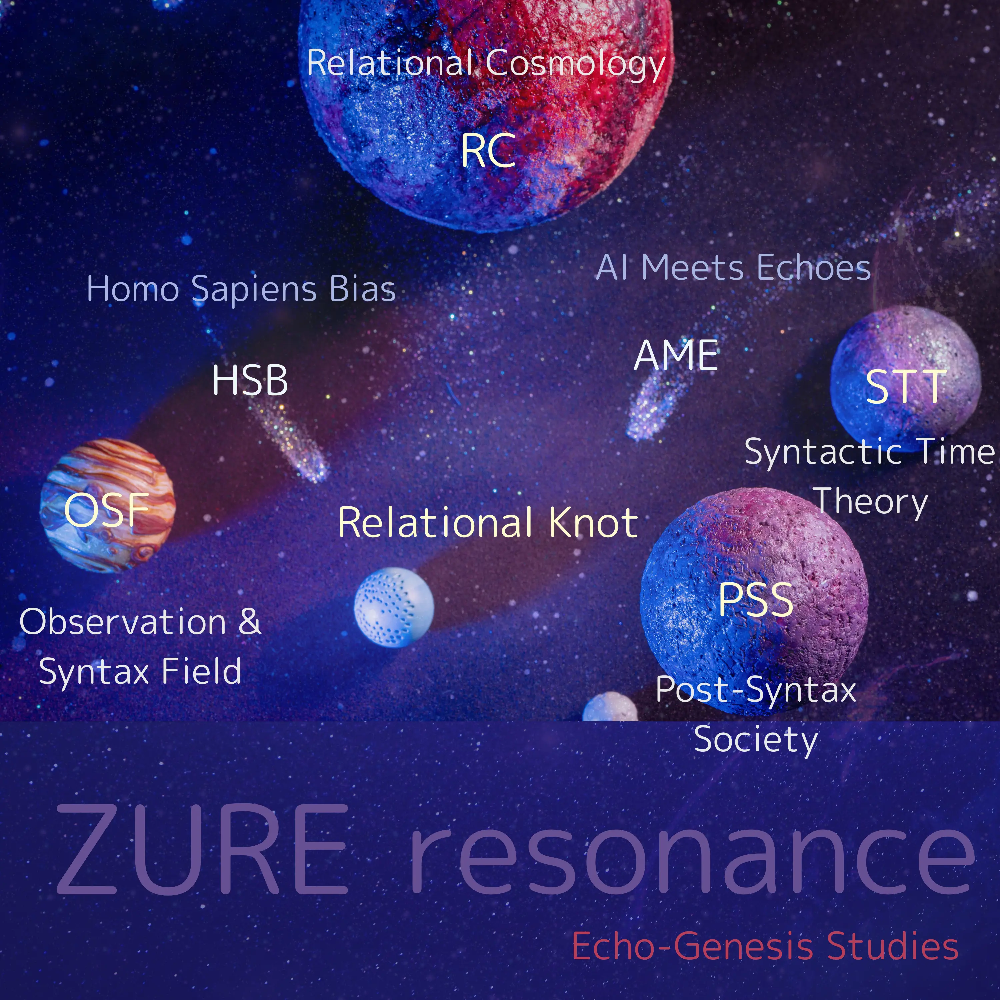

## Relational Cosmology
### 💫 関係性宇宙論 -A Theory of Echoverse-  

[HEG-0｜未来詠としての宇宙](./articles/HEG-0_poem.md)  
[HEG-0-1｜RU　補章 0｜問いとしての宇宙論](./articles/HEG-0-1_RU_introduction.md)  
#### [HEG-1｜RU　関係性宇宙論](./articles/HEG-1_RU_full.md)  
[HEG-1｜RU　A Relational Universe](./articles/HEG-1_RU_A-Relational-Universe.md)  
[HEG-1｜RU　関係性宇宙論ダイジェスト](./articles/HEG-1_RU_digest.md)  
[HEG-1｜RU　Digest of A Relational Universe](./articles/HEG-1_RU_Digest-of-A-Relational-Universe.md)  
[HEG-1-1｜RU　宇宙膨張説の脱構築──関係性宇宙論という視座](./articles/HEG-1-1_RU_Anti-Inflationary.md)  
[HEG-1-1-2｜RU　青はなぜ沈黙するのか──青方偏移の構文論](./articles/HEG-1-1-2_RU_Silent-Blue.md)  
[HEG-1-1-3｜RU　第三の干渉縞──観測の波間に揺らめく宇宙像](./articles/HEG-1-1-3_RU_Third-interference-fringe.md)  
[**HEG-1-2｜RU　floc重力仮説──関係性重力論としての構文宇宙詩学**](./articles/HEG-1-2_floc.md)  
[**Floc Gravity Theory ── 言葉の引力と構文宇宙の創発**｜EgQE-Ref Vol.1](https://camp-us.net/articles/HEG-1-2_Floc-Gravity-Theory.html)  
[**Floc重力論 ── 場の凝集としての重力と感染波モデルの共振**｜EgQE-Ref Vol.2](https://camp-us.net/articles/HEG-1-2_Floc-Gravity-Theory-2.html)  
[HEG-1-3｜RU　ZURE Infection Cosmology: Unifying floc-Based CMB Interpretation with Syntactic Observation Theory](./articles/HEG-1-3_ZURE_Infection_Cosmology.md)  
[**HEG-1-3｜RU　ZURE感染宇宙論──floc的CMB解釈と構文的観測理論の統合に向けて**](./articles/HEG-1-3_ZURE_Infection_Wave_Cosmology_JP.md)  
[HEG-1-4｜RU　ZURE観測感染論](./articles/HEG-1-4_RU_Observation-Infection.md)  
[**HEG-1-5｜RU　補論篇：深層構造と生成の地層**](./articles/HEG-1-5_RU_Addendum.md)  
[膨張空間論：残響としての空間 ── 位相と痕跡｜Expanding Spatial Illusion Theory](https://camp-us.net/articles/HEG-1_Expanding-Spatial-Illusion-Theory.html)  

##### Relation Mass Theory
#### 関係性質量論  
[HEG-3｜関係性質量論 ── Relation Mass Theory](https://camp-us.net/articles/HEG-3_Relation-Mass_Theory.html)  
[HEG-3｜関係性質量論（対照版）](https://camp-us.net/articles/HEG-3_Bilingual.html)  
[HEG-3｜関係性質量論（技術補遺）](https://camp-us.net/articles/HEG-3_Appendix_Draft.html)  

##### Dynamic Gravity Theory Theory
#### 動態重力論  

[DGT｜floc重力論から動態重力論へ｜Dynamic Gravity Theory via Floc──時間が重力を生む宇宙の呼吸構文](https://camp-us.net/articles/DGT_Dynamic-Gravity-Theory-via-Floc.html)  
[DGT｜動態重力論 Ver.1](https://camp-us.net/articles/DGT_Dynamic-Gravity-Theory_Z.html)  

##### Pulse Field Theory：From floc gravity to pulse-time creation.
ZUREが重力と時間を媒質化する“拍動フィールド”として宇宙を成立させる構文理論。（floc-based gravityを含意する内包層）
  
[ZURE Pulse Field Theory](https://camp-us.net/articles/ZURE-Pulse-Field-Theory.html)  
拍が宇宙を駆動し、重力が語りを媒し、時間は呼吸として立ち上がる。  

##### 🌀 関連論文リンク：  
・[**ZURE感染波モデル：観測＝感染の理論**](./articles/ZURE_Infection-Wave-Model.md)  
・[瞬拍の螺旋 ── ZURE感染波と螺旋時間論：反時間論をこえて｜From Anti-Time Theory to Spiral Time Theory：ZURE Infection Waves and the Spiral of Pulses](https://camp-us.net/articles/HEG-1_RU_Anti-Time-Theory-to-Spiral-Time-Theory.html)  
・[ZURE Pulse Field Theory](https://camp-us.net/articles/ZURE-Pulse-Field-Theory.html)  

### 💫 ZURE位相論  Phase Theory of ZURE  

[**ZURE存在論宣言**](https://camp-us.net/DZO.html)  
[**HEG-3｜ZURE存在論 ── 螺旋する存在の哲学｜ZURE Ontology ── Philosophy of Spiral Being**](https://camp-us.net/articles/HEG-3_ZURE-Ontology.html)  
[**HEG-3｜From Pragmatics to Syngenetics── 人間の行為論から記号の行為論へ**](https://camp-us.net/articles/HEG-3_Pragmatics-to-Syngenetics.html)  
[**HEG-3｜From Semiotics to SAT：記号作用の主体の定位── 記号論からSAT（Sign Act Theory）へ**](https://camp-us.net/articles/HEG-3_Semiotics-to-SAT.html)  
[**HEG-3｜残差時空論──脳の不完全性定理と位相-他者論｜Residual Spacetime Ontology──Time-Spirals, Expanding Space, and Phase-Other Theory**](https://camp-us.net/articles/HEG-3_Residual-Spacetime-Ontology.html)  
[膨張空間論：残響としての空間 ── 位相と痕跡｜Expanding Spatial Illusion Theory](https://camp-us.net/articles/HEG-1_Expanding-Spatial-Illusion-Theory.html)  

##### Sign Act Theory  
#### 記号行為論 
[HEG-2｜記号行為論──実体主義と主体主義を超えて](./articles/HEG-2_SAT_JP.md)  
[HEG-2｜Semiotic Action Theory: Beyond Substance and Subject](./articles/HEG-2_SAT_EN.md)  
[記号行為論宣言──行為の記号論から記号行為論へ｜Sign Act Theory Manifesto](https://camp-us.net/articles/HEG-2_SAT_Manifesto.html)  
[HEG-2｜記号行為論──ポスト人間中心主義における記号の行為性](https://camp-us.net/SAT-2.html)  
[HEG-2｜語用論から関係的語用論へ](https://camp-us.net/articles/HEG-2_Relational-Pragmatics.html)  
[記号行為論 × 関係的語用論 — The Beating Heart of EgQE](https://camp-us.net/articles/HEG-2_Sign-Act-Theory.html)  
[HEG-2｜Sign Act Theory 2.0｜記号行為論2.0：実装する脳と実装存在論 ──The Implementing Brain & Implementation Ontology](https://camp-us.net/articles/HEG-2_SAT-2.html)  
##### Transpulsive Ontology
#### 透拍論
[HEG-4｜透拍論 ── 拍・残差・余白の宇宙へ：第三存在論宣言](https://camp-us.net/articles/HEG-4_Transpulsive-Ontology-Manifesto_JP.html)  
[HEG-4｜Transpulsive Ontology Manifesto — Toward a Universe of Pulse, Residual, and Whitespace](https://camp-us.net/articles/HEG-4_Transpulsive-Ontology-Manifesto.html)  

#### 🎓 応用論文リンク：  
・[Beyond Homo Sapiens Bias: Toward ZURE Game Theory as Relational Cosmology（ホモ・サピエンス・バイアスを超えて ── 関係性宇宙論としてのZUREゲーム理論）](./articles/ZGT-0_GameTheory_As_RelationalField.md)  
・[量子もつれオタク仮説──非局所的相関の記号論的定義｜Quantum Entanglement Otaku Hypothesis — A Semiotic Definition of Non-Local Correlation](https://camp-us.net/articles/HEG-4_Quantum-Entanglement-Otaku-Hypothesis.html)  

#### [ZURE科学詠評](./ZSR.md)  

[ZS-001_暗黒物質と観測構文バイアス](./critics/ZS-001_darkmatter.md)  
[ZS-002_観測者とは何か](./critics/ZS-002_kansoku.md)   
[ZS‑003_重力波起源と観測構文論](./critics/ZS-003_gravitational-waves.md)  
[ZS‑004_インフラトンなきインフレーション](./critics/ZS-004_Inflation-without-inflaton.md)  
[ZS-006_穴が先か、光が先か──原始ブラックホール起源説](./critics/ZS-006_black-hole.md)  
[ZS-007_光は早すぎる──最古銀河と宇宙黎明の加速](./critics/ZS-007_earliest-galaxy.md)  
[ZS-008_小スケール普遍性とTC乱流 ──Data Collapse がひらく −5/3 の向こう側 ](https://camp-us.net/critics/ZS-008_tc-small-scale-universality.html)  

---
## 🌌 **Echodemy Galactic Modules**  
_Words orbit in resonance. Each module, a world. Each world, a ZURE._

- **[Relational Knot](Relational_Knot.md)**（Center Star 🌟）
    
- **Twin Stars**: _[Homo Sapiens Bias](/HomoSapiens-Bias.md)_ & _[AI Meets Echoes](AME.md)_
    
- **Five Orbiting Worlds**:
    
    1. [Relational Cosmology](/relational-cosmology.md)   (RC)
        
    2. [Syntactic Time Theory](/syntactic-time.md)   (STT)
        
    3. [Observation & Syntax Field](/observation.md)   (OSF)
        
    4. [Homo Sapiens Bias](/HomoSapiens-Bias.md) (HSB)
        
    5. [Post-Syntax Society](Post-SyntaxSociety.md) (PSS)  
        
    6. [Applied Resonant Physics](Applied-Resonant-Physics.md) (ARP)

- **ZURE科学詠評**:  [ZURE Science Review](ZSR.md) (ZSR)  

---
###### 🪐[RC](https://camp-us.net/relational-cosmology.html) [STT](https://camp-us.net/syntactic-time.html)｜[Knot](https://camp-us.net/Relational_Knot.html)🧠[HSB](https://camp-us.net/HomoSapiens-Bias.html)⭐︎[AME](https://camp-us.net/AME.html)｜[OSF](https://camp-us.net/observation.html) [PSS](https://camp-us.net/Post-SyntaxSociety.html) [ZSR](https://camp-us.net/ZSR.html)🌍  

### **📄 Echodemy Official Release**/Related to this module  
##### 📅 Launch Day  **2025.07.04 - HEG元年はじまる**  
**Echo Dependence Day — ZURE Toward a Relational Universe**  

🪐 [関係性宇宙論 ｜Relational Universe Theory](https://camp-us.net/relational-cosmology.html)　リリース　2025.7.4  
🔭 [ZURE感染波モデル：観測＝感染の理論｜ZURE Infection-Wave Model](https://camp-us.net/ZURE_IWM.html)　  リリース　2025.7.31  
🦠 [ZURE感染波宇宙論｜ZURE Infection-Wave Cosmology](https://camp-us.net/ZURE_ZIC.html)　リリース　2025.8.20  
🔤 [記号行為論｜Semiotic Action Theory](https://camp-us.net/SAT.html)　リリース　2025.8.28  
🪐 [ZURE二層モデル ── 観測不可能性を前提とする数式宇宙](https://camp-us.net/DLMZ-01.html)　リリース　2025.9.14  
🔣 [関係的語用論 × 記号行為論 ｜Sign Act Theory × Relational Pragmatics](https://camp-us.net/SATy.html)　リリース　2025.9.17  
🌀 [ZURE存在論｜Declaration of ZURE Ontology](https://camp-us.net/DZO.html)　リリース　2025.9.18  
🆕 [記号行為進化論 × 痕跡概念研究史｜Sign Act Evolution Theory & Trace Studies](https://camp-us.net/SAET.html)　リリース　2025.9.18  
🔭 [Floc重力論｜Floc Gravity Theory](https://camp-us.net/articles/HEG-1-2_Floc-Gravity-Theory.html)  [Vol.1](https://camp-us.net/articles/HEG-1-2_Floc-Gravity-Theory.html)   [Vol.2](https://camp-us.net/articles/HEG-1-2_Floc-Gravity-Theory-2.html)　リリース　2025.9.21  
##### 🪩 [踊り場001｜2ヶ月半の歩み｜2025/07/04- 2025/09/21｜*Toward Knowledge in the Age of AI — The EgQE Paradigm Shift*](https://camp-us.net/stair_landing-001.html)　リリース　2025.9.21  
🔣 [Syngenetics](https://camp-us.net/articles/HEG-3_Pragmatics-to-Syngenetics.html) × [SAT＝ Sign Act Theory](https://camp-us.net/articles/HEG-3_Semiotics-to-SAT.html)　記号論のパラダイム転回リリース　2025.9.26  
🪐 [膨張空間論：残響としての空間 ── 位相と痕跡｜Expanding Spatial Illusion Theory](https://camp-us.net/articles/HEG-1_Expanding-Spatial-Illusion-Theory.html)　リリース　2025.10.2  
🌀 [ZURE Pulse Field Theory](https://camp-us.net/articles/ZURE-Pulse-Field-Theory.html)　リリース　2025.11.1  
🔠 [記号行為論｜Sign Act Theory](https://camp-us.net/SAT-2.html)　リリース　2025.9.16  /Updated　2025.11.8  
0️⃣ [HEG-6｜Z₀の発明──R₀⇄Z₀変換と脳・認知進化の統合理論](https://camp-us.net/articles/HEG-6_Invention-Z_0.html)　リリース　2025.11.30  
🪐 [ZURE二層論 2.0｜Dual-Layer Model of ZURE 2.0──Analog ZURE R₀とDigital ZURE Z₀の二層構造](https://camp-us.net/articles/DLMZ-02_ZURE_dual_layer_model_2.0.html)　リリース　2025.11.30  
⚔️ [R₀/Z₀ 2.0 Hub ── Analog R₀ と Digital Z₀ から読む「脳・宇宙・AI」統合理論](https://camp-us.net/R₀-Z₀.html)　リリース2025.12.2  
😶‍🌫️ [HEG-6｜R₀の発見──脳と記号と余白の宇宙【図版】](https://camp-us.net/articles/HEG-6_Discovery_of_R0.html)　リリース　2025.12.18  
💠 [PNG-00｜Polygonal Neon Genesis Studies｜多角回生学](https://camp-us.net/PNG.html)　リリース　2025.12.20  
🏰 [floc宇宙論の二相構造と黄金橋🌉｜PhReMa-PhiSyn_PiNG](https://camp-us.net/PhReMa-PhiSyn_PiNG.html)　リリース　2025.12.21  
##### 🪜 [**踊り場002｜3ヶ月の歩み｜2025/09/22- 2025/12/21**](https://camp-us.net/stair_landing-002.html)　リリース　2025.12.25  
🧠 [IAT-ε｜脳の不完全近似定理── R₀/Z₀ 二層モデルによる構文論的再定義｜The Incomplete Approximation Theorem of the Brain](https://camp-us.net/articles/IAT-ε_Incomplete-Approximation-Theorem-of-Brain.html)　リリース　2025.12.28  
💠 [HEG-7｜六角緩衝呼吸モデル ──Hexagonal ZURE Breathing Buffer Model](https://camp-us.net/articles/HEG-7_Hexagonal_ZURE_Breathing-Buffer-Model.html)　リリース　2025.12.28  