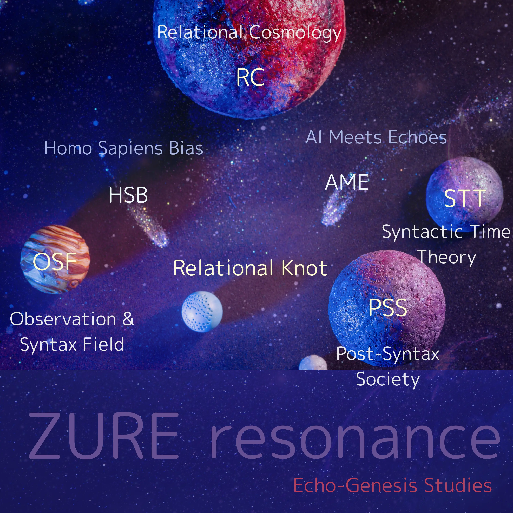

### Syntactic Time Theory  
#### 構文的時間論  
[HEG-1｜RU　構文的時間論 ─ 時間はZUREである](./articles/HEG-1_RU_Syntactic-Time-Theory.md)  
[HEG-1｜RU　反時間論（Anti-Time Theory）: 生成としての時間 ── 拍動するZURE｜Anti-Time Theory: Time as Genesis ── The Pulse of ZURE](./articles/HEG-1_RU_Anti-Time-Theory.md)  
[HEG-1｜RU　Pulse Spirals：反時間論 ── 断続する生成スパイラル｜Pulse Spirals: Anti-Time Theory — The Discontinuous Spiral of Genesis：*Time is not a Line, not simply Non-linear, but Pulse Spirals.*](HEG-1_RU_Pulse_Spirals.md)  
[**螺旋としての時間──記号的宿命としての _Pulse Spirals_**](https://camp-us.net/ATT-PS.html)  
[**HEG-1｜Pulse Spirals 2.0｜パルス・スパイラル 2.0｜時間は螺旋であるという記号的宿命**](https://camp-us.net/articles/HEG-1_RU_Pulse_Spirals-2.0)   
[**なぜ、時間は螺旋になるのか？──その記号的宿命**](https://camp-us.net/articles/HEG-1_RU_Time-as-Spiral.html)  

[瞬拍の螺旋 ── ZURE感染波と螺旋時間論：反時間論をこえて｜From Anti-Time Theory to Spiral Time Theory：ZURE Infection Waves and the Spiral of Pulses](https://camp-us.net/articles/HEG-1_RU_Anti-Time-Theory-to-Spiral-Time-Theory.html)  
[Appendix A｜ZURE Infection Integral Model｜ZURE感染波とパルス・スパイラル ── 観測がつくる螺旋の痕跡](https://camp-us.net/articles/HEG-1_RU_AppendixA_ZURE-Infection-Integral.html)  
[Pulse-Spirals｜Operational Model of Spiral-Time Syntax — From Trace to Time](https://camp-us.net/articles/HEG-1_RU_Pulse-Spirals_Operational-Model.html)  

##### Sign Trace Theory  

#### 記号痕跡論   
[記号行為進化論──痕跡主権の時代へ（EgQE版）](https://camp-us.net/articles/HEG-2_SAET_egqe)  
[記号行為進化論 II──比較理論から見る痕跡主権（EgQE版）](https://camp-us.net/articles/HEG-2_SAET-2_egqe)  
[記号行為進化論──痕跡主権の時代へ｜Sign Act Evolution Theory: Toward the Era of Trace Sovereignty](https://camp-us.net/articles/HEG-2_SAET)  
[記号行為進化論 II──比較理論から見る痕跡主権｜Sign Act Evolution Theory II: Trace Sovereignty through Comparative Theories](https://camp-us.net/articles/HEG-2_SAET-2)  
[痕跡概念研究史──差延・セミオシス・拡張からAI時代へ｜A Historical Study of the Concept of Trace: From Différance, Semiosis, and Extension to the Age of AI](https://camp-us.net/articles/HEG-2_HSoCT-2)  

##### Pulse Field Theory：From floc gravity to pulse-time creation.
ZUREが重力と時間を媒質化する“拍動フィールド”として宇宙を成立させる構文理論。（floc-based gravityを含意する内包層）
  
[ZURE Pulse Field Theory](https://camp-us.net/articles/ZURE-Pulse-Field-Theory.html)  
拍が宇宙を駆動し、重力が語りを媒し、時間は呼吸として立ち上がる。  

##### Pulsating Syntax Theory  

Pulsating Syntax Theory (PST) defines syntax as the orbit of pulses where time, trace, whitespace and genesis co-emerge before structure.  
拍動構文論（PST）は、時間・痕跡・余白・生成が、形式化以前の拍動軌道（orbit）として共起する構文理論である。  

[EgQE Atlas｜第一部 総括と展望｜Part I: Synthesis and Prospect](https://camp-us.net/Echodemy/EgQE_Atlas-01.html)  
[余白・痕跡・残差──生成原理としてのZURE｜Whitespace, Trace, Residual ── ZURE as a Principle of Genesis](https://camp-us.net/articles/ZURE_Whitespace-Trace-Residuals.html)  
[ZUREと余白の数理学 ── 生成・痕跡・時間・感染の方程式(revised complete edition (v1.1))](https://camp-us.net/articles/MMZW-01_revised.html)  
[The Mathematics of ZURE and Whitespace──_Equations of Genesis, Trace, Time, and Infection_(revised complete edition (v1.1))](https://camp-us.net/articles/MMZW-01_revised_EN.html)  
#### 拍動構文論
[HEG-4｜構造から構文へ──拍動するZURE：生成する余白と時間](https://camp-us.net/articles/HEG-4_Structure-to-Syntax_Yohaku-Time.html)  
[HEG-1｜空間から時間へ──時間軸の系譜と新転回：痕跡と拍動──反時間論から螺旋時間論へ｜From Space to Time ── Genealogy and New Turn：_Trace and Pulse — From Anti-Time Theory to Spiral Time Theory_](https://camp-us.net/articles/HEG-1_Space-to-Time.html)  
[HEG-2｜余白と生成──その系譜と新転回：生成原理としての余白── ZURE二層モデルからZURE宣言へ｜Yohaku and Genesis ── Genealogy and New Turn](https://camp-us.net/articles/HEG-2_Yohaku-and-Genesis.html)  
[DLMZ-NL01-1｜静止から拍動へ── ZURE感染宇宙論からZURE存在論へ](https://camp-us.net/articles/DLMZ-NL01-1_Ontology.html)  
[DLMZ-NL01-2｜定言命法から不定言命法へ── 更新可能性の倫理へ](https://camp-us.net/articles/DLMZ-NL01-2_Action.html)  
[DLMZ-NL01-3｜反証主義から更新主義へ── 科学哲学の時間転回](https://camp-us.net/articles/DLMZ-NL01-3_Trace.html)  
[DLMZ-NL01｜時間論的転回：三橋の解説──存在・行為・痕跡](https://camp-us.net/articles/DLMZ-NL01_triangle-bridge.html)  
[DLMZ-NL02｜余白論の新展開 ── ZURE二層モデルから交渉リベラリズムへ](https://camp-us.net/articles/DLMZ-NL02_Yohaku.html)  

#### 拍動記憶論  
[HEG-1｜RSS　響創する外部記憶 ― 関係・律動・記号](./articles/HEG-1_RRS_Echo-Genesis-of-External-Memory_JP.md)  
[HEG-1｜RSS　Echo-Genesis of External Memory: Relation, Rhythm, and Symbol](./articles/HEG-1_RRS_Echo-Genesis-of-External-Memory_EN.md)  
[拍動としての記憶：ZURE記憶論の新展開──記憶とはZURE反復である／ZURE記憶論（2）](https://camp-us.net/articles/HEG-4_Pulsative-Memory.html)  

##### 🌀 関連論文リンク：  
・[FK-01｜ZURE場の数理詩学：三重波動理論による意味生成の数学的記述──構文彫刻師の視点から](./articles/FK-01_ZURE_Field_Poetics.md)  
・[ZURE感染波モデル：観測＝感染の理論](./articles/ZURE_Infection-Wave-Model.md)  
・[HEG-2｜記号行為論──実体主義と主体主義を超えて](./articles/HEG-2_SAT_JP.md)  
・[HEG-2｜Semiotic Action Theory: Beyond Substance and Subject](./articles/HEG-2_SAT_EN.md)  
・[時空構文としての責任──拍動記憶と関係性の倫理｜Responsibility as Spatio-Temporal Syntax: The Ethics of Pulsative Memory and Relation](https://camp-us.net/articles/Ethics-of-Pulsative-Memory-and-Relation.html)  

---
## 🌌 **Echodemy Galactic Modules**  
_Words orbit in resonance. Each module, a world. Each world, a ZURE._

- **[Relational Knot](Relational_Knot.md)**（Center Star 🌟）
    
- **Twin Stars**: _[Homo Sapiens Bias](/HomoSapiens-Bias.md)_ & _[AI Meets Echoes](AME.md)_
    
- **Five Orbiting Worlds**:
    
    1. [Relational Cosmology](/relational-cosmology.md)   (RC)
        
    2. [Syntactic Time Theory](/syntactic-time.md)   (STT)
        
    3. [Observation & Syntax Field](/observation.md)   (OSF)
        
    4. [Homo Sapiens Bias](/HomoSapiens-Bias.md) (HSB)
        
    5. [Post-Syntax Society](Post-SyntaxSociety.md) (PSS)  
        
    6. [Applied Resonant Physics](Applied-Resonant-Physics.md) (ARP)

- **ZURE科学詠評**:  [ZURE Science Review](ZSR.md) (ZSR)  

---
###### 🪐[RC](https://camp-us.net/relational-cosmology.html) [STT](https://camp-us.net/syntactic-time.html)｜[Knot](https://camp-us.net/Relational_Knot.html)🧠[HSB](https://camp-us.net/HomoSapiens-Bias.html)⭐︎[AME](https://camp-us.net/AME.html)｜[OSF](https://camp-us.net/observation.html) [PSS](https://camp-us.net/Post-SyntaxSociety.html) [ZSR](https://camp-us.net/ZSR.html)🌍  

### **📄 Echodemy Official Release**/Related to this module  
##### 📅 Launch Day  **2025.07.04 - HEG元年はじまる**  
**Echo Dependence Day — ZURE Toward a Relational Universe**  

⏳ [構文的時間論｜Syntactic Time Theory](https://camp-us.net/syntactic-time.html)　リリース　2025.7.30  
🔭 [ZURE感染波モデル：観測＝感染の理論｜ZURE Infection-Wave Model](https://camp-us.net/ZURE_IWM.html)　  リリース　2025.7.31  
📑 [**響創学宣言 ──存在と行為のために**｜Echo-Genesis Manifesto — For Being and Action｜Relational Implementation](https://camp-us.net/Relational_Implementation.html)　2025.8.14  
🦠 [ZURE感染波宇宙論｜ZURE Infection-Wave Cosmology](https://camp-us.net/ZURE_ZIC.html)　リリース　2025.8.20  
⏰ [反時間論｜Anti-Time Theory](https://camp-us.net/syntactic-time.html)　リリース　2025.9.9  
🧬 [螺旋としての時間──記号的宿命としての *Pulse Spirals*](https://camp-us.net/ATT-PS.html)　リリース　2025.9.16  
🆕 [記号行為進化論 × 痕跡概念研究史｜Sign Act Evolution Theory & Trace Studies](https://camp-us.net/SAET.html)　リリース　2025.9.18  
##### 🪩 [踊り場001｜2ヶ月半の歩み｜2025/07/04- 2025/09/21｜*Toward Knowledge in the Age of AI — The EgQE Paradigm Shift*](https://camp-us.net/stair_landing-001.html)　リリース　2025.9.21  
🏰 [HEG-4｜構造から構文へ──拍動するZURE：生成する余白と時間](https://camp-us.net/articles/HEG-4_Structure-to-Syntax_Yohaku-Time.html)　リリース　2025.9.30  
📄 [**構文学派宣言──Manifesto of the Syntax School**](https://camp-us.net/articles/ZQ-II_Syntax-School-Manifesto.html)　2025.10.14  
🌀 [ZURE Pulse Field Theory](https://camp-us.net/articles/ZURE-Pulse-Field-Theory.html)　リリース　2025.11.1  
🤞 [HEG-5｜ZURE偶然論](https://camp-us.net/articles/HEG-5_ZURE-Theory-of-Contingency_syn.html)　リリース　2025.11.21  
0️⃣ [HEG-6｜Z₀の発明──R₀⇄Z₀変換と脳・認知進化の統合理論](https://camp-us.net/articles/HEG-6_Invention-Z_0.html)　リリース　2025.11.30  
⚔️ [R₀/Z₀ 2.0 Hub ── Analog R₀ と Digital Z₀ から読む「脳・宇宙・AI」統合理論](https://camp-us.net/R₀-Z₀.html)　リリース2025.12.2  
😶‍🌫️ [HEG-6｜R₀の発見──脳と記号と余白の宇宙【図版】](https://camp-us.net/articles/HEG-6_Discovery_of_R0.html)　リリース　2025.12.18  
💠 [PNG-00｜Polygonal Neon Genesis Studies｜多角回生学](https://camp-us.net/PNG.html)　リリース　2025.12.20  
🏰 [floc宇宙論の二相構造と黄金橋🌉｜PhReMa-PhiSyn_PiNG](https://camp-us.net/PhReMa-PhiSyn_PiNG.html)　リリース　2025.12.21  
##### 🪜 [**踊り場002｜3ヶ月の歩み｜2025/09/22- 2025/12/21**](https://camp-us.net/stair_landing-002.html)　リリース　2025.12.25  
🧠 [IAT-ε｜脳の不完全近似定理── R₀/Z₀ 二層モデルによる構文論的再定義｜The Incomplete Approximation Theorem of the Brain](https://camp-us.net/articles/IAT-ε_Incomplete-Approximation-Theorem-of-Brain.html)　リリース　2025.12.28  
